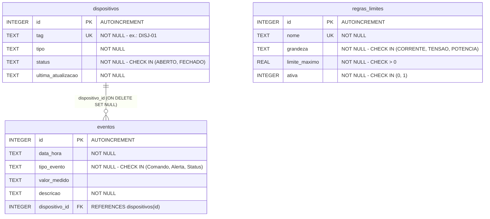

# SmartGrid — Supervisório de Energia (IHM Desktop)

Software desktop que atua como uma **Interface Homem-Máquina (IHM) de supervisão energética**, responsável por processar os sinais analógicos e digitais recebidos de um microcontrolador e permitir a intervenção do operador em tempo real.

Projeto da disciplina **Desenvolvimento de Aplicações Computacionais** — Unoesc.

---

## Sumário

- [Equipe](#equipe)
- [Visão Geral](#visão-geral)
- [Escopo das Entregas](#escopo-das-entregas)
- [Entrega A1/2 — Persistência, Logs e Robustez](#entrega-a12--persistência-logs-e-robustez)
  - [Persistência em SQLite](#persistência-em-sqlite)
  - [Transações atômicas e tratamento de erros](#transações-atômicas-e-tratamento-de-erros)
  - [Configuração em JSON](#configuração-em-json-dataconfigjson)
  - [Log de auditoria](#log-de-auditoria-logssmartgridlog)
  - [Modo de falha simulada](#modo-de-falha-simulada-demonstração-do-rollback)
  - [Roteiro da arguição técnica](#roteiro-da-arguição-técnica)
- [Entrega A1/1 — Requisitos Obrigatórios](#entrega-a11--requisitos-obrigatórios)
- [Entrega Final (Dezembro) — Requisitos Funcionais](#entrega-final-dezembro--requisitos-funcionais)
  - [1. Processamento e Apresentação de Telemetria](#1-processamento-e-apresentação-de-telemetria-hardware--desktop)
  - [2. Monitoramento de Estado Binário e Segurança](#2-monitoramento-de-estado-binário-e-segurança-hardware--desktop)
  - [3. Atuação e Parametrização do Sistema](#3-atuação-e-parametrização-do-sistema-desktop--hardware)
  - [4. Gestão de Histórico e Auditoria](#4-gestão-de-histórico-e-auditoria-logs-em-tabela)
- [Arquitetura e Organização do Código](#arquitetura-e-organização-do-código)
- [Organização do Trabalho em Equipe](#organização-do-trabalho-em-equipe)
- [Tecnologias](#tecnologias)
- [Como Executar](#como-executar)
- [Checklist da Entrega A1/2](#checklist-da-entrega-a12)
- [Checklist da Entrega A1/1](#checklist-da-entrega-a11)
- [Forma de Entrega e Apresentação (A1/2)](#forma-de-entrega-e-apresentação-a12)
- [Forma de Entrega e Apresentação (A1/1)](#forma-de-entrega-e-apresentação-a11)
- [Regras Obrigatórias do Git](#regras-obrigatórias-do-git)
- [Critérios Avaliativos (A1/2)](#critérios-avaliativos-a12)
- [Critérios Avaliativos (A1/1)](#critérios-avaliativos-a11)
- [Opção de Tema Livre](#-opção-de-tema-livre-prototipagem-de-microcontroladores)

---

## Equipe

| Integrante | Usuário GitHub | A1/1 | A1/2 |
|---|---|---|---|
| Samuel De Marco | [@SamuelDeMarco-Dev](https://github.com/SamuelDeMarco-Dev) | Arquitetura MVC, janela principal e Dashboard de Monitoramento | Camada `database/`, esquema e transações, corte emergencial atômico, `main.py` de inicialização e integração final |
| Davy Josias Scheuermann | [@Davyjosias01](https://github.com/Davyjosias01) | Painel de Configuração da Comunicação Serial | Log de auditoria, `config.json`, tela serial persistente, modo de falha simulada e README |
| Lucas Zamoner Locatelli | [@lucaszlocatelli](https://github.com/lucaszlocatelli) | Diálogo Modal de Limites e Parâmetros | Regras de limite no SQLite, validações do diálogo, repositório de dispositivos e auditoria de SQL |
| Arthur De Marco Faggion | [@ArthurDeMarcoF](https://github.com/ArthurDeMarcoF) | Histórico de Eventos e Registros | Eventos no SQLite, filtros e limpeza transacional do histórico, testes de rollback e roteiro de demonstração |

> ⚠️ Todos os integrantes devem possuir commits registrados em seu próprio usuário do GitHub. Ver [Regras Obrigatórias do Git](#regras-obrigatórias-do-git).

**Repositório:** https://github.com/SamuelDeMarco-Dev/SmartGrid

---

## Visão Geral

O software supervisor recebe continuamente as amostras brutas dos sensores do microcontrolador — via comunicação serial no futuro, ou **simuladas nesta entrega** — e:

1. Processa e apresenta a telemetria elétrica (tensão, corrente e potência);
2. Monitora o estado binário do disjuntor/chave de proteção;
3. Permite atuação sobre a carga (relé) e parametrização de limites de alerta;
4. Centraliza todo o histórico de eventos em uma tabela de auditoria;
5. Persiste eventos, limites e estado dos dispositivos em **SQLite**, com transações atômicas;
6. Guarda a configuração da comunicação em **`data/config.json`** e registra a operação em **`logs/smartgrid.log`**.

```
┌──────────────────┐        Serial (Unidade 4)        ┌──────────────────────┐
│  Microcontrolador│  ──────  V_RMS, I_RMS, estado ──▶ │                      │
│  (ACS712 /       │                                   │  SmartGrid Desktop   │
│   ZMPT101B /     │  ◀──────  RELAY_OFF, setpoints ── │  (IHM Supervisória)  │
│   Relé / Disj.)  │                                   │                      │
└──────────────────┘                                   └──────────────────────┘
```

---

## Escopo das Entregas

| Entrega | Data | Escopo |
|---|---|---|
| **A1/1** | 17/08/2026 | Arquitetura MVC, navegação entre janelas, layout responsivo e interface gráfica completos. **Sem conexão física com o hardware.** |
| **A1/2** | 19/10/2026 | **Persistência, Logs e Robustez:** SQLite com integridade relacional, transações atômicas (ACID), configuração em JSON, log de auditoria e tratamento preventivo de erros. |
| **Final** | Dezembro | Integração serial real, processamento de telemetria, atuação sobre o relé, proteção por setpoint e auditoria completa. |

> Na entrega A1/1 a aplicação **não precisa estar fisicamente conectada ao hardware** — a integração serial ocorrerá na Unidade 4. No entanto, toda a arquitetura de código em camadas (MVC), navegação entre janelas, layout responsivo e interface gráfica devem estar prontos.

---

## Entrega A1/2 — Persistência, Logs e Robustez

Na A1/1 os dados viviam só na memória. Na A1/2:

- o **histórico de eventos**, os **limites de segurança** e o **estado dos dispositivos** passam a ser gravados em banco relacional (**SQLite**);
- a aplicação tolera erros de usuário e falhas de processo com **transações atômicas (ACID)** e **validação preventiva**;
- os parâmetros de inicialização e comunicação ficam em arquivo estruturado (**JSON**);
- toda anomalia, corte de carga ou erro de execução é registrado em **arquivo de log** para auditoria.

### Persistência em SQLite

O banco `data/smartgrid.db` é criado automaticamente por `Database.init_db()` (`database/connection.py`) na abertura do app. As tabelas usam `CREATE TABLE IF NOT EXISTS` e os dados iniciais só são inseridos com as tabelas vazias, então chamar `init_db()` de novo não duplica nada.

**Modelo relacional:**



| Tabela | Guarda | Dados iniciais |
|---|---|---|
| `dispositivos` | Estado do disjuntor principal e do relé de emergência | `DISJ-01` (Disjuntor principal) e `RELE-01` (Relé de emergência), ambos `FECHADO` |
| `eventos` | Histórico exibido na `QTableWidget` | — |
| `regras_limites` | Limites cadastrados no diálogo modal | Sobrecorrente 15 A (ativa), Sobretensão 230 V (ativa), Pico de Potência 3500 W (inativa) |

O esquema e os dados iniciais ficam em `database/schema.py`.

**Integridade:** `PRIMARY KEY`, `NOT NULL`, `UNIQUE`, restrições `CHECK` e chave estrangeira `eventos.dispositivo_id → dispositivos.id`. Toda conexão aberta por `Database.conectar()` executa `PRAGMA foreign_keys = ON;`, usa `timeout=5` segundos contra bloqueios de concorrência e devolve linhas nomeadas (`sqlite3.Row`).

**Repositórios (CRUD)** — camada `models/`, sempre com SQL parametrizado (`?`):

| Repositório | Operações |
|---|---|
| `RepositorioEventos` | `listar_todos()`, `filtrar(tipo, data_inicio)`, `adicionar(evento)`, `limpar()` |
| `RepositorioRegras` | `obter_regras()`, `salvar_regras(lista)` (troca o conjunto inteiro numa única transação) |
| `RepositorioDispositivos` | `listar()`, `obter_por_tag(tag)`, `atualizar_status(tag, status)` |

Todo método que escreve aceita um parâmetro opcional `conn`: com ele, participa de uma transação maior em vez de abrir a própria. É isso que permite o corte emergencial gravar dispositivo e evento juntos.

**Integração com a interface:**

- A tabela do Histórico carrega os dados do banco no `showEvent`, via `RepositorioEventos.listar_todos()` (ou `filtrar` com filtros aplicados). Não existem mais dados estáticos.
- Eventos gerados na tela (corte emergencial, alarme de limite, disparo do disjuntor, conexão serial) são publicados no barramento, gravados no SQLite pelo `GravadorEventos` e só então emitidos como `evento_persistido`, que atualiza a tabela. **A tabela nunca mostra um evento que não está no banco.**
- O dashboard restaura o estado do disjuntor a partir de `dispositivos` ao abrir.

### Transações atômicas e tratamento de erros

`Database.transacao()` é o gerenciador de contexto (`with`) usado em toda escrita:

```python
with Database.transacao() as conn:   # BEGIN
    ...                              # comandos com ?
                                     # COMMIT ao sair sem erro
# Qualquer exceção → ROLLBACK, log [ERROR] "Rollback executado: <motivo>" e a exceção é relançada.
```

Ele cumpre o papel do `with conn:` do `sqlite3`, com `BEGIN`, `COMMIT` e `ROLLBACK` explícitos.

**Corte emergencial "tudo ou nada"** (`models/servico_corte.py`, `ServicoCorteEmergencial`), numa única transação:

1. `UPDATE` de `DISJ-01` e `RELE-01` para `ABERTO` (ou `FECHADO`, no religamento);
2. ponto de injeção de falha do [modo de falha simulada](#modo-de-falha-simulada-demonstração-do-rollback);
3. `INSERT` do evento de comando no histórico.

Se qualquer passo falhar, nada é gravado: os dispositivos continuam como estavam, nenhum evento entra no histórico, a interface não muda de estado e o operador recebe um `QMessageBox.critical`. Só depois do `COMMIT` o resto da aplicação é avisado pelo barramento.

**Validação preventiva** (antes de tocar no banco), sempre com `QMessageBox.warning` e `[WARNING]` no log:

| Tela | Entradas recusadas |
|---|---|
| Diálogo de Limites | nome vazio ou duplicado, limite vazio, **letras em campo numérico**, valor negativo ou zero |
| Comunicação Serial | porta não selecionada, timeout vazio, com letras, negativo ou fora de 100 a 10 000 ms |
| Histórico | data inicial de filtro inválida |

Erros de banco (`sqlite3.Error`) e de disco são capturados nos controllers, viram `QMessageBox.critical` e `[ERROR]` no log, e a interface não quebra com traceback. Nenhum `except: pass` é usado.

### Configuração em JSON (`data/config.json`)

Gerenciada por `ConfigManager` (`models/config_manager.py`). Guarda o que muda de uma máquina para outra e o interruptor de teste:

| Chave | Padrão | Regra |
|---|---|---|
| `porta_com` | `"COM1"` | texto não vazio |
| `baud_rate` | `115200` | 9600, 19200, 38400, 57600 ou 115200 |
| `timeout_ms` | `1000` | inteiro de 100 a 10 000 (milissegundos) |
| `simular_falha_corte` | `false` | verdadeiro ou falso |

```json
{
  "porta_com": "COM3",
  "baud_rate": 9600,
  "timeout_ms": 2000,
  "simular_falha_corte": false
}
```

- **Arquivo inexistente:** `ConfigManager.carregar()` confere com `os.path.exists` e, se não existir, cria o arquivo com os padrões (`[INFO]` no log).
- **JSON corrompido:** o app abre com os padrões e registra `[WARNING]`, sem sobrescrever o arquivo estragado.
- **Campo inválido ou ausente:** só aquele campo volta ao padrão (`[WARNING]`), os demais são mantidos.
- **Gravação atômica:** `ConfigManager.salvar()` grava em `config.json.tmp` e troca o arquivo com `os.replace`, para que uma interrupção nunca deixe o JSON pela metade.
- **Tela serial:** abre com a última configuração e salva porta, baud rate e timeout a cada conexão bem-sucedida. Se a porta salva não existir na máquina, seleciona a primeira disponível (`[WARNING]`).

Os limites de alerta ficam na tabela `regras_limites` do banco, que é a fonte oficial deles (valores iniciais em `database/schema.py`).

### Log de auditoria (`logs/smartgrid.log`)

Configurado por `configurar_log()` (`models/log_config.py`) com o módulo nativo `logging`, primeira instrução do `main.py`. O arquivo é criado automaticamente, gravado em UTF-8 e atualizado a cada registro. Os módulos obtêm o logger por `obter_logger()`.

**Formato:** `AAAA-MM-DD HH:MM:SS [NÍVEL] descrição`

| Nível | Quando |
|---|---|
| `INFO` | Operação normal concluída: banco inicializado, conexão serial, corte bem-sucedido, histórico limpo |
| `WARNING` | Situação anormal tratada: limite violado, entrada inválida, configuração corrompida, modo de teste ativado |
| `ERROR` | Falha ou exceção, inclusive rollback de transação |

**Exemplo de uma sessão:**

```text
2026-10-19 08:00:01 [INFO] Conexão com SQLite estabelecida e esquema validado.
2026-10-19 08:00:15 [INFO] Comunicação serial conectada: COM3 @ 9600 bps (timeout 1000 ms).
2026-10-19 08:01:02 [WARNING] Limite de corrente violado: 28.5A (Limite configurado: 25.0A).
2026-10-19 08:01:40 [WARNING] Entrada inválida em limites: limite_maximo='abc'
2026-10-19 08:02:10 [WARNING] Modo de falha simulada ativado.
2026-10-19 08:02:18 [ERROR] Falha na operação de corte emergencial. Rollback executado: Falha simulada entre corte e histórico.
2026-10-19 08:02:30 [WARNING] Modo de falha simulada desativado.
2026-10-19 08:02:41 [INFO] Corte de emergência acionado via software (RELAY_OFF) — disjuntor e relé em ABERTO.
```

### Modo de falha simulada (demonstração do rollback)

Faz o corte de emergência falhar **de propósito** depois de atualizar os dispositivos e antes de gravar o evento no histórico. Serve para provar que a transação é desfeita e o banco volta ao estado anterior. Implementado em `models/modo_falha.py` (`ModoFalhaSimulada`).

**Como ativar:**

- durante a execução: **`Ctrl+Shift+F`** liga e desliga (vale só enquanto o app estiver aberto);
- ao abrir o app: `"simular_falha_corte": true` em `data/config.json`.

Com o modo ativo, a barra de status mostra o selo vermelho **MODO DE TESTE: falha simulada**, e cada troca fica no log (`[WARNING] Modo de falha simulada ativado.` / `desativado.`).

**Conferindo o rollback no banco** (antes e depois do corte com falha, os resultados devem ser iguais):

```powershell
python -c "import sqlite3; c = sqlite3.connect('data/smartgrid.db'); print(c.execute('SELECT tag, status FROM dispositivos').fetchall()); print(c.execute('SELECT COUNT(*) FROM eventos').fetchone())"
```

Com o `sqlite3` instalado, o equivalente é `sqlite3 data/smartgrid.db "SELECT tag, status FROM dispositivos; SELECT COUNT(*) FROM eventos;"`.

Desativando o modo (`Ctrl+Shift+F` de novo), o corte volta a funcionar: os dispositivos passam para `ABERTO` e o evento aparece no histórico.

### Roteiro da arguição técnica

Os três cenários exigidos na demonstração, executando o código clonado do GitHub. A divisão de quem faz cada passo está em [`docs/roteiro-demonstracao.md`](docs/roteiro-demonstracao.md).

1. **Falha de validação:** no diálogo de limites, deixar um campo vazio, digitar letras e um valor negativo; na tela serial, informar um timeout inválido. Cada caso é bloqueado com `QMessageBox` e nada é gravado.
2. **Falha transacional com rollback:** consultar o banco, ativar o modo de falha simulada (`Ctrl+Shift+F`), acionar o **Corte de Emergência**, ver a mensagem de erro e consultar o banco de novo: nada mudou. Desativar o modo e repetir o corte, agora com sucesso.
3. **Auditoria em tempo real:** abrir `logs/smartgrid.log` e apontar os `[WARNING]` das validações, o `[ERROR] ... Rollback executado: ...` e o `[INFO]` do corte bem-sucedido.

---

## Entrega A1/1 — Requisitos Obrigatórios

### 1. Dashboard Principal de Monitoramento (Smart Grid)

- **Leituras de Telemetria:** indicadores visuais para Tensão (V), Corrente (A) e Potência Calculada (W).
- **Indicador de Estado Binário:** sinalizador visual (LED virtual ou *badge*) indicando o status do Disjuntor/Chave de Proteção (**Aberto / Fechado**).
- **Comandos de Acionamento:** botão de **"Corte Emergencial de Carga"** (relé), confirmação por `QMessageBox` e registro do comando no histórico.
- **Configuração de Limites:** acesso ao diálogo modal de limites, com regras de alerta aplicadas ao dashboard por meio do barramento.
- **Gráfico de Tendência (com carga inicial de dados):** área de plotagem (`pyqtgraph`) exibindo a curva de demanda das últimas 24 horas, **preenchida com dados amostrais no momento em que a tela abre**.

### 2. Painel de Configuração da Comunicação Serial

- Seleção de **Porta COM** (`QComboBox`);
- **Baud Rate** (9600, 115200, além de 19200, 38400 e 57600);
- **Timeout** em milissegundos;
- Botões de **Conectar / Desconectar**.
- Atualização do status visual da conexão e publicação do estado no barramento.

> Nesta etapa A1/1, a tela valida e simula a abertura da porta para integração visual. A comunicação real com o microcontrolador fica para a entrega final. Na A1/2 a tela passou a ler e gravar a configuração em [`data/config.json`](#configuração-em-json-dataconfigjson).

### 3. Janela de Configuração de Limites / Parâmetros (`QDialog` Modal)

- Formulário secundário para cadastro de **regras de alerta** (ex.: limite máximo de corrente, limite máximo de tensão);
- **No mínimo duas regras**;
- Envio e resgate correto de parâmetros para a tela principal;
- Validações com `QMessageBox` e persistência em memória durante a execução (na A1/2, persistência na tabela `regras_limites` do SQLite).

### 4. Histórico de Eventos e Registros (`QTableWidget`)

- Tabela para listagem de eventos do sistema, incluindo:
  - registros de cortes de emergência;
  - ultrapassagem de limite de corrente;
  - trocas de estado do disjuntor.
- Filtros por tipo de evento e data inicial;
- Limpeza do histórico com confirmação;
- Eventos recebidos em tempo real pelo barramento (na A1/2, carregados do SQLite e atualizados a cada evento gravado).

---

## Entrega Final (Dezembro) — Requisitos Funcionais

### 1. Processamento e Apresentação de Telemetria (Hardware → Desktop)

O software recebe continuamente as amostras brutas dos sensores do microcontrolador.

**Leitura e Tratamento de Tensão (V) e Corrente (A)**

- Ler a **tensão eficaz (V<sub>RMS</sub>)** e a **corrente (I<sub>RMS</sub>)** enviadas pelo sensor (ex.: **ACS712** para corrente / **ZMPT101B** para tensão).

**Cálculo da Potência Ativa (P)**

- Calcular a potência instantânea aproximada em **Watts (W)** ou **Quilowatts (kW)** através da relação:

```
P = V × I
```

**Renderização no Dashboard**

- Exibir os valores instantâneos de **V**, **I** e **P** em indicadores numéricos de alta visibilidade (`QLCDNumber` ou `QLabel` customizadas com destaque de cor);
- Atualizar o **Gráfico de Tendência Temporal** (`pyqtgraph`) plotando a curva de consumo de potência ao longo do tempo. O gráfico deve ser inicializado com **histórico pré-carregado** no momento da abertura da tela.

### 2. Monitoramento de Estado Binário e Segurança (Hardware → Desktop)

O software monitora o estado físico do **disjuntor/chave de proteção geral** da instalação.

**Sinalização Visual de Estado (Aberto / Fechado)**

| Estado | Significado | Sinalização |
|---|---|---|
| **Fechado** | Energizado / Normal | Indicador **verde** — *"Disjuntor: FECHADO / NORMAL"* |
| **Aberto** | Desenergizado / Trip / Falha | Indicador **vermelho** — *"Disjuntor: ABERTO / PROTEÇÃO ATIVADA"* |

**Detecção e Registro de Eventos de Disparo**

- Sempre que o estado mudar **espontaneamente** no hardware (ex.: disjuntor caiu por sobrecarga), o software deve:
  - disparar um aviso visual (`QMessageBox.warning`);
  - gerar um **registro automático** na tabela de histórico.

### 3. Atuação e Parametrização do Sistema (Desktop → Hardware)

**Corte Emergencial da Carga (Relé de Saída)**

- Botão de grande destaque: **"CORTE DE EMERGÊNCIA"** / **"DESLIGAR CARGA"**;
- Ao ser acionado, exibe uma **caixa de confirmação modal** (`QMessageBox.question`);
- Se confirmado, envia o comando binário (ex.: `RELAY_OFF`) para o microcontrolador abrir o relé.

**Ajuste de Limite de Alerta de Consumo (Setpoints)**

- O operador define um **limite máximo tolerável** de corrente ou potência através de campo numérico (`QDoubleSpinBox`) no diálogo de limites.

**Lógica Local de Proteção de Software**

- Se a potência calculada ultrapassar o **setpoint** configurado pelo usuário, o software deve:
  - alterar a cor do dashboard para **amarelo/vermelho**;
  - emitir um **alerta visual**;
  - **registrar a ocorrência de sobrecorrente**.

### 4. Gestão de Histórico e Auditoria (Logs em Tabela)

Toda a atividade do sistema é centralizada na `QTableWidget` de registros:

| Coluna | Descrição do Dado | Exemplo de Preenchimento |
|---|---|---|
| **Data / Hora** | Carimbo de data/hora exato do evento (*timestamp*) | `10/08/2026 10:30:15` |
| **Tipo de Evento** | Categoria do evento registrado | `Comando`, `Alerta` ou `Status` |
| **Descrição** | Detalhes do evento ou valor medido na ocorrência | `Corte de emergência acionado via software` |
| **Valor Medido** | Potência/Corrente no momento do evento | `12.5 A / 2750 W` |

---

## Arquitetura e Organização do Código

### Padrão MVC — Separação Estrita de Pastas

```
SmartGrid/
├── main.py                        # Ponto de entrada: log → config → banco → telas
├── requirements.txt
├── requirements-dev.txt           # requirements.txt + pytest
├── .gitignore
├── database/                      # Conexão e esquema SQLite
│   ├── __init__.py
│   ├── connection.py              # Database: init_db, conectar (timeout, pragmas), transacao
│   └── schema.py                  # DDL das 3 tabelas e dados iniciais
├── controllers/                   # Lógica das janelas e eventos (Signals & Slots)
│   ├── __init__.py
│   ├── dashboard_controller.py
│   ├── historico_controller.py
│   ├── limites_dialog_controller.py
│   ├── main_window_controller.py  # Shell, barra de status e atalho do modo de teste
│   └── serial_config_controller.py
├── models/                        # Regras de negócio, entidades e repositórios
│   ├── __init__.py
│   ├── aquisicao.py               # Serviço que publica telemetria simulada
│   ├── barramento.py              # Canal de sinais compartilhado entre telas
│   ├── config_manager.py          # Leitura e escrita do data/config.json
│   ├── estado_disjuntor.py
│   ├── evento.py
│   ├── gravador_eventos.py        # Grava no SQLite os eventos publicados no barramento
│   ├── leitura.py
│   ├── log_config.py              # Configuração do logs/smartgrid.log
│   ├── modo_falha.py              # Interruptor do modo de falha simulada
│   ├── porta_serial.py            # Validação e simulação da porta serial
│   ├── regra_alerta.py
│   ├── repositorio_dispositivos.py
│   ├── repositorio_eventos.py
│   ├── repositorio_regras.py
│   ├── servico_corte.py           # Corte emergencial transacional
│   └── simulador_telemetria.py
├── tests/                         # Testes automatizados (pytest)
├── docs/
│   └── roteiro-demonstracao.md
├── data/                          # smartgrid.db e config.json (gerados, fora do Git)
├── logs/                          # smartgrid.log (gerado, fora do Git)
├── ui/                            # Arquivos .ui e versões geradas pelo pyuic6
│   ├── __init__.py
│   ├── dashboard.ui
│   ├── dashboard_ui.py
│   ├── estilo.qss                 # Folha de estilo global
│   ├── historico.ui
│   ├── historico_ui.py
│   ├── limites_dialog.ui
│   ├── limites_dialog_ui.py
│   ├── main_window.ui
│   ├── main_window_ui.py
│   ├── serial_config.ui
│   └── serial_config_ui.py
└── README.md
```

### Regras de Encapsulamento

- **Nenhuma regra de negócio ou evento** deve ser escrita diretamente dentro dos arquivos gerados pelo Qt Designer;
- Os arquivos `_ui.py` em `/ui` permanecem **completamente isolados** — são descrições de layout geradas pelo `pyuic6`;
- Os arquivos `.ui` são mantidos como fonte editável do Qt Designer, e a folha `ui/estilo.qss` centraliza a aparência global;
- Toda lógica de interação, validação visual e conexão de sinais vive em `/controllers`;
- As regras de negócio, entidades, repositórios SQLite (sempre com SQL parametrizado `?`), configuração, log, simulação de telemetria e serial ficam em `/models`;
- A conexão, o esquema e as transações do banco ficam em `/database`. Nenhum SQL é escrito em `/ui` ou `/controllers`;
- `main.py` permanece como ponto de entrada e composição, nesta ordem: configura o log, carrega o `config.json`, inicializa o banco, cria o gravador de eventos e o serviço de corte, monta a janela principal e registra as telas no shell.

### Comunicação entre as Telas — Barramento de Eventos

Nenhum controller importa outro controller. As telas conversam por sinais publicados em `models/barramento.py`, o que as mantém independentes e permite o desenvolvimento em paralelo:

| Sinal | Emitido por | Consumido por |
|---|---|---|
| `leitura_recebida(Leitura)` | Serviço de aquisição | Dashboard (indicadores e gráfico) |
| `evento_registrado(Evento)` | Qualquer tela (pedido de gravação) | `GravadorEventos` |
| `evento_persistido(Evento)` | `GravadorEventos` e serviço de corte, **após o COMMIT** | Histórico de Eventos |
| `estado_disjuntor_alterado(EstadoDisjuntor)` | Serviço de corte / aquisição | Dashboard (badge e comandos) |
| `regras_alteradas(list[RegraAlerta])` | Diálogo de Limites | Dashboard (proteção por setpoint) |
| `status_conexao_alterado(bool, str)` | Painel Serial | Janela principal, Dashboard e serviço de aquisição |

```python
from models.barramento import barramento
from models.evento import TipoEvento

barramento.evento_persistido.connect(self._adicionar_linha)
barramento.registrar_evento(TipoEvento.COMANDO, "Corte de emergência acionado", "12.50 A / 2750 W")
```

Um evento só chega ao Histórico depois de gravado: a tela publica `evento_registrado`, o `GravadorEventos` grava no SQLite e emite `evento_persistido`. Se a gravação falhar, o erro vai para o log e o evento não aparece na tabela.

A janela principal expõe `registrar_pagina(nome, widget)` e `ir_para(nome)`. O `main.py` usa esses métodos para encaixar `DashboardController`, `SerialConfigController` e `HistoricoController` no `QStackedWidget` do shell.

### Compilação das Telas do Qt Designer

Após editar um `.ui`, recompile e **versione os dois arquivos** (`.ui` e `_ui.py`):

```bash
pyuic6 -o ui/nome_da_tela_ui.py ui/nome_da_tela.ui
```

---

## Organização do Trabalho em Equipe

O trabalho está dividido em **milestones e issues no GitHub**, com propriedade exclusiva de arquivos: cada tela é dona do seu `.ui`, do seu controller e dos seus models específicos. Assim ninguém edita o arquivo de ninguém e não há conflito de merge.

**A1/2 — Persistência, Logs e Robustez:**

| Milestone | Conteúdo |
|---|---|
| **M0 — Fundação de Persistência** | Camada `database/`, esquema SQLite, transações, módulo de log e `.gitignore` |
| **M1 — Persistência por Módulo** | Eventos, regras, dispositivos, `config.json` e corte transacional, em paralelo |
| **M2 — Integração & Robustez** | Fiação final, modo de falha simulada, testes de integridade e rollback |
| **M3 — Documentação & Entrega** | README, roteiro de demonstração, integração final e auditoria de commits |

**A1/1 — Telas (concluída):**

| Milestone | Conteúdo |
|---|---|
| **M0 — Fundação MVC & Contratos** ✅ | Estrutura de pastas, `main.py`, shell da janela principal e entidades compartilhadas em `/models` |
| **M1 — Entrega A1/1: Telas** ✅ | As 4 telas obrigatórias, desenvolvidas em paralelo — uma por integrante |
| **M2 — Integração & Entrega** ✅ | Fiação das telas no shell, padronização visual, checklist de entrega |

Os contratos de `/models` estão **congelados**: qualquer campo novo passa por comentário na issue correspondente e PR específico. O mesmo vale para o esquema do banco em `database/schema.py`.

### Fluxo de trabalho

```bash
git switch main && git pull            # sempre partir do main atualizado
git switch -c feat/minha-tela          # branch própria
# ... commits pequenos e frequentes ...
git pull --rebase origin main          # antes de abrir o PR
```

- Ninguém commita direto em `main` — toda entrega passa por **Pull Request**.
- Mensagens no padrão `tipo(escopo): descrição`, ex.: `feat(dashboard): pré-carrega gráfico com histórico de 24h`.
- Commits distribuídos ao longo do período. Ver [Regras Obrigatórias do Git](#regras-obrigatórias-do-git).

---

## Tecnologias

| Item | Uso |
|---|---|
| **Python 3** | Linguagem base |
| **PyQt6** | Framework da interface gráfica |
| **Qt Designer** | Construção visual das telas (`.ui`) com uso de *Layouts* |
| **pyqtgraph** | Gráfico de tendência de consumo |
| **numpy** | Apoio ao processamento e manipulação de dados numéricos |
| **pyserial** | Comunicação serial com o microcontrolador *(Unidade 4)* |
| **sqlite3** *(nativo)* | Banco relacional local `data/smartgrid.db` |
| **json** *(nativo)* | Arquivo de configuração `data/config.json` |
| **logging** *(nativo)* | Log de auditoria `logs/smartgrid.log` |
| **pytest** *(desenvolvimento)* | Testes automatizados |

### Componentes Qt Utilizados

`QLCDNumber` · `QLabel` · `QComboBox` · `QLineEdit` · `QDoubleSpinBox` · `QPushButton` · `QTableWidget` · `QDateEdit` · `QDialog` (modal) · `QMessageBox` (`question` / `warning` / `critical`) · `QStatusBar` · `QShortcut`

---

## Como Executar

```powershell
git clone https://github.com/SamuelDeMarco-Dev/SmartGrid.git
cd SmartGrid
```

No Windows PowerShell:

```powershell
py -m venv .venv
.\.venv\Scripts\Activate.ps1
```

Com o ambiente virtual ativo:

```powershell
python -m pip install -r requirements.txt
python main.py
```

Se a política de execução bloquear a ativação do ambiente virtual, use diretamente o Python da `.venv`:

```powershell
.\.venv\Scripts\python.exe -m pip install -r requirements.txt
.\.venv\Scripts\python.exe main.py
```

No Linux/macOS:

```bash
python3 -m venv .venv
source .venv/bin/activate
python -m pip install -r requirements.txt
python main.py
```

> Execute sempre a partir da raiz do projeto (`SmartGrid/`) — é de lá que os pacotes `ui`, `controllers` e `models` são importados.

**Requisitos:** Python 3.10 ou superior. As dependências documentadas são exatamente as de `requirements.txt`: `PyQt6`, `pyqtgraph`, `numpy` e `pyserial`.

### Testes e auditoria SQL

No PowerShell, instale as dependências de desenvolvimento e execute os testes:

```powershell
python -m pip install -r requirements-dev.txt
python -m pytest -q
```

Os testes usam banco, configuração e log em pastas temporárias: não alteram o `data/` nem o `logs/` reais. As telas são testadas sem abrir janela.

| Arquivo | O que cobre |
|---|---|
| `tests/test_database.py` | Restrições `CHECK`, chave estrangeira e `init_db()` sem duplicar dados |
| `tests/test_transacoes.py` | Rollback de dispositivos e eventos, gravação conjunta e limpeza atômica do histórico |
| `tests/test_config_manager.py` | Criação do `config.json`, JSON corrompido, campos inválidos e gravação atômica |
| `tests/test_serial_config_controller.py` | Tela serial lendo e gravando a configuração, validação do timeout e log |
| `tests/test_modo_falha.py` | Interruptor do modo de teste, atalho `Ctrl+Shift+F` e selo da barra de status |

As consultas devem usar parâmetros `?`. Estes comandos devem terminar sem ocorrências:

```powershell
rg -n 'execute(many)?\(\s*f["'']' -g '*.py' .
rg -n '(SELECT|INSERT|UPDATE|DELETE).*\.format\(' -g '*.py' .
rg -n '(SELECT|INSERT|UPDATE|DELETE).*%\s*(\(|[A-Za-z_])' -g '*.py' .
```

---

## Checklist da Entrega A1/2

| Exigência | Onde é atendida |
|---|---|
| `smartgrid.db` criado automaticamente por `Database.init_db()` | `database/connection.py` |
| Tabelas de dispositivos, histórico de eventos e regras/limites | `database/schema.py` |
| `PRIMARY KEY`, `NOT NULL`, `CHECK(status IN ('ABERTO','FECHADO'))` e `PRAGMA foreign_keys = ON;` | `database/schema.py`, `Database.conectar()` |
| CRUD nos repositórios, com SQL parametrizado (`?`) | `models/repositorio_*.py` |
| `QTableWidget` carregada do banco via `listar_todos()` | `HistoricoController.showEvent` |
| Novos eventos gravados no SQLite e refletidos na tabela | `GravadorEventos` → `evento_persistido` |
| Validação preventiva com `QMessageBox` (vazio, letras, negativo) | Diálogo de Limites e tela Serial |
| Corte emergencial "tudo ou nada" (disjuntor + evento) | `ServicoCorteEmergencial` com `Database.transacao()` |
| `timeout` contra bloqueio e nenhum `except: pass` | `Database.conectar()` e controllers |
| `config.json` lido e salvo, criado com padrões via `os.path.exists` | `models/config_manager.py`, tela Serial |
| `smartgrid.log` com timestamp e `[INFO]` / `[WARNING]` / `[ERROR]` | `models/log_config.py` |
| `.gitignore` com `__pycache__/`, `.venv/`, `.vscode/`, `*.db-wal`, `*.db-journal` | `.gitignore` |
| Estrutura `database/`, `models/`, `controllers/`, `ui/`, `logs/`, `data/`, `main.py` | [Arquitetura](#padrão-mvc--separação-estrita-de-pastas) |
| Demonstração: validação, rollback e auditoria do log | [Roteiro da arguição](#roteiro-da-arguição-técnica) |

---

## Checklist da Entrega A1/1

- [x] Critério 1 — Arquitetura MVC e separação de responsabilidades
- [x] Critério 2 — Interface gráfica, layouts e navegação
- [x] Critério 3 — Telemetria, disjuntor e gráfico pré-carregado
- [x] Critério 4 — QDialog, QTableWidget, QComboBox, QDateEdit e QMessageBox
- [x] Critério 5 — README, Git e organização do trabalho

---

## Forma de Entrega e Apresentação (A1/2)

- **Envio do Projeto:** repositório atualizado com o projeto na data de entrega.
- **Apresentação em Sala:** no dia **19/10/2026**, no laboratório, as equipes fazem uma **demonstração prática executando o código clonado do próprio GitHub**, simulando ativamente os cenários de falha (ver [Roteiro da arguição](#roteiro-da-arguição-técnica)).

## Forma de Entrega e Apresentação (A1/1)

- **Envio do Projeto:** submissão do link do repositório GitHub no Google Forms até **17/08/2026**.
- **Apresentação em Sala:** no dia **17/08/2026**, no laboratório, as equipes farão uma **demonstração prática executando o código clonado do próprio GitHub**.

---

## Regras Obrigatórias do Git

> **Leia com atenção.**

- **Evolução do Código:** os commits devem demonstrar a **evolução progressiva** do projeto ao longo do período de desenvolvimento. **Enviar todo o código em um único commit no dia da entrega não será aceito.**
- **Avaliação Individual:** a participação de cada membro é **auditada pelo histórico do Git**. O aluno que **NÃO** possuir commits registrados em seu usuário do GitHub receberá **nota ZERO** na entrega.
- **Padrão de Mensagens:** manter um padrão coerente nas mensagens de commit.
- **Continuidade (A1/2):** o desenvolvimento da A1/2 continua no mesmo repositório da A1/1.

---

## Critérios Avaliativos (A1/2)

| # | Categoria | Critério Detalhado | Nota Máx. |
|---|---|---|---|
| **1** | **Persistência de Dados & SQLite** | • Modelagem e criação automática do banco `smartgrid.db` com integridade relacional (`PRIMARY KEY`, `NOT NULL`, restrições `CHECK` e ativação de `FOREIGN KEY`)<br>• Implementação completa das rotinas de CRUD nos Repositórios (atuadores/disjuntor, histórico de eventos e limites de alerta)<br>• Integração direta do banco com a interface: carregamento dinâmico na inicialização e atualização em tempo real do `QTableWidget` | **2,5 pts** |
| **2** | **Robustez, Exceções & Transações ACID** | • Validações preventivas de entrada no `QDialog` (campos numéricos, vazios ou negativos) com feedback via `QMessageBox`<br>• Controle transacional seguro na rotina de "Corte Emergencial": integridade "tudo ou nada" (atualização do disjuntor + registro de evento)<br>• Prevenção de bloqueios de concorrência com `timeout` configurado e tratamento refinado de exceções sem `except: pass` | **2,5 pts** |
| **3** | **Arquivos Estruturados (JSON) & Logs** | • Leitura e escrita íntegra de parâmetros de inicialização e comunicação serial no `config.json`, tratando arquivo inexistente (`os.path.exists`)<br>• Geração contínua do `smartgrid.log` registrando eventos operacionais, erros e desarmes com timestamp e severidade (`INFO`, `WARNING`, `ERROR`) | **1,5 pt** |
| **4** | **Governança, Versionamento & Auditoria Git** | • Repositório ativo com continuidade do histórico da A1/1 e mensagens descritivas<br>• `.gitignore` na raiz impedindo o envio de `__pycache__/`, `.venv/` e arquivos temporários de banco<br>• Distribuição equitativa de commits (aluno sem commits nesta etapa recebe nota zero) | **1,5 pt** |
| **5** | **Qualidade do Código & Padrão MVC** | • Arquitetura em camadas (`/ui`, `/controllers`, `/models`, `/database`, `main.py`)<br>• Isolamento completo dos arquivos do Qt Designer (nenhuma regra de negócio ou SQL em `/ui`)<br>• Boas práticas de POO, código limpo e SQL parametrizado com placeholders (`?`) | **1,0 pt** |
| **6** | **Arguição Técnica & Simulação de Falhas** | • Demonstração prática executando o código clonado do GitHub<br>• Simulação ativa de falhas: erros de entrada no formulário e interrupção no corte de emergência comprovando o `ROLLBACK`<br>• Auditoria ao vivo dos registros no `smartgrid.log` | **1,0 pt** |
| | **NOTA TOTAL** | | **10,0 pts** |

## Critérios Avaliativos (A1/1)

| # | Categoria | Critério Detalhado | Nota Máx. |
|---|---|---|---|
| **1** | **Arquitetura de Software & Padrão MVC** | • Separação estrita de pastas (`/ui`, `/controllers`, `/models`, `main.py`)<br>• Isolação completa dos arquivos compilados pelo Qt Designer (nenhuma regra de negócio dentro da pasta `/ui`)<br>• `main.py` enxuto, funcionando apenas como ponto de partida da aplicação<br>• Organização de classes, boas práticas de POO e legibilidade do código em Python | **2,5 pts** |
| **2** | **Interface Gráfica (UI/UX) & Layouts Responsivos** | • Utilização de *Layouts* no Qt Designer para alinhamento dos componentes (evitando elementos sobrepostos ou desalinhados)<br>• Organização visual clara, boa distribuição dos elementos e hierarquia das informações (títulos, campos e botões bem definidos)<br>• Padronização estética (cores, fontes) e facilidade na navegação entre as janelas | **2,0 pts** |
| **3** | **Módulo de Telemetria & Gráfico Pré-carregado (Smart Grid)** | • Presença e funcionamento dos indicadores visuais para Tensão (V), Corrente (A) e Potência Calculada (P = V × I)<br>• Indicador gráfico de status do disjuntor (Aberto / Fechado) com mudança visual de cor/estado<br>• Área de gráfico (PyQtGraph ou Matplotlib) inicializada com dados pré-carregados simulando a curva de consumo | **2,0 pts** |
| **4** | **Componentes Avançados & Múltiplas Janelas** | • Janela secundária de configuração (`QDialog` modal) com envio e resgate correto de parâmetros para a tela principal<br>• Uso funcional e preenchimento correto de `QTableWidget` (histórico de eventos), `QComboBox`, `QDateEdit` e validações com `QMessageBox` | **2,0 pts** |
| **5** | **Governança, Versionamento & Auditoria Git** | • Repositório ativo e bem estruturado no GitHub/GitLab com arquivo `README.md` identificando a equipe e o projeto<br>• Distribuição equitativa de commits entre todos os integrantes da equipe (auditado pelo histórico do Git)<br>• Padrão coerente nas mensagens de commit | **1,5 pt** |
| | **NOTA TOTAL** | | **10,0 pts** |

---

## 💡 Opção de Tema Livre (Prototipagem de Microcontroladores)

As equipes que preferirem podem aplicar o software supervisor a um **protótipo físico/projeto desenvolvido em disciplinas como Microcontroladores, Microprocessadores ou Sistemas Embarcados**, desde que o projeto atenda aos **mesmos requisitos** de leitura analógica/digital e acionamento de atuadores.
