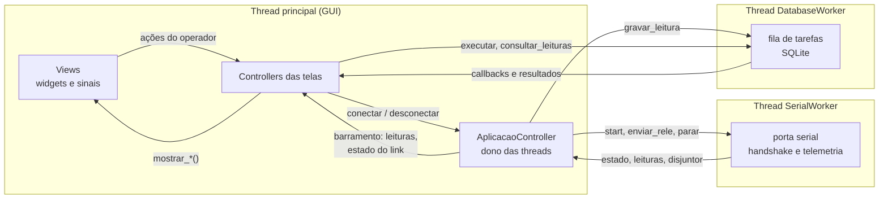
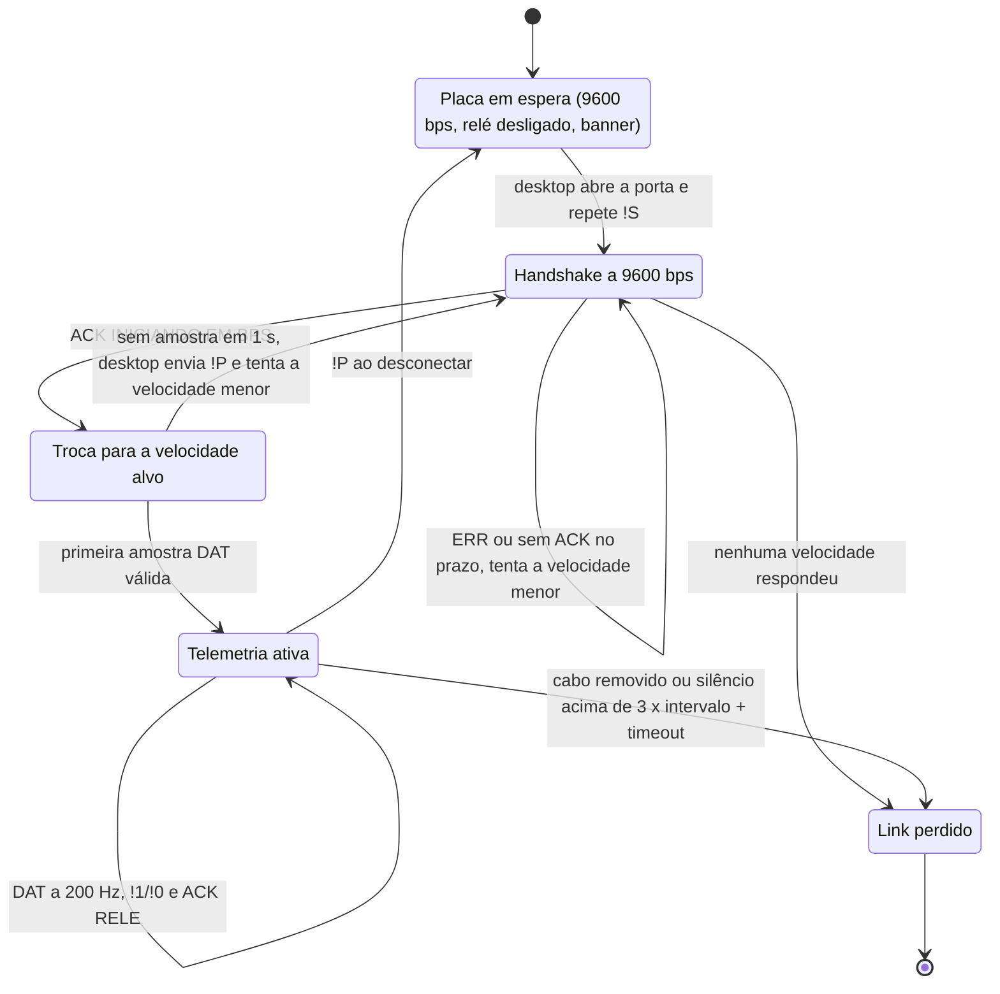
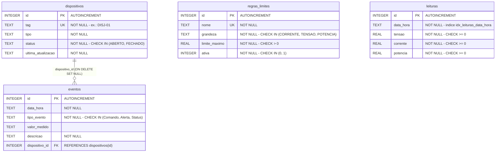
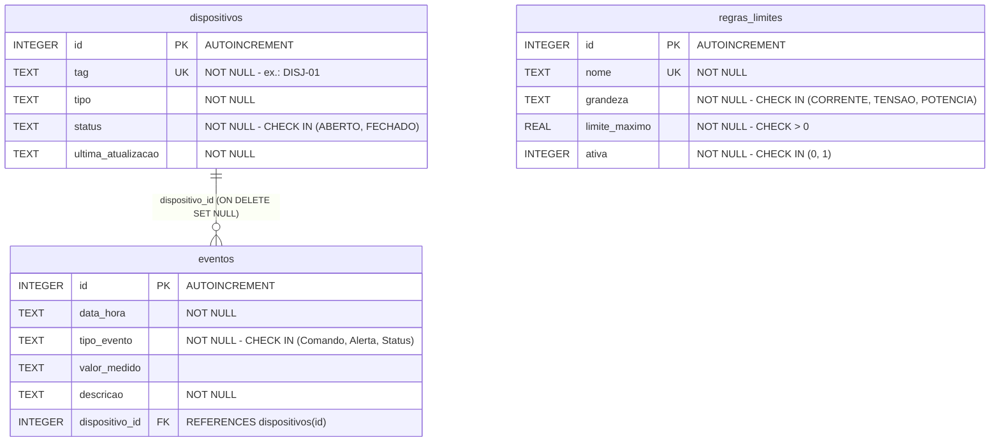

# SmartGrid — Supervisório de Energia (IHM Desktop)

Software desktop que atua como uma **Interface Homem-Máquina (IHM) de supervisão energética**, responsável por processar os sinais analógicos e digitais recebidos de um microcontrolador e permitir a intervenção do operador em tempo real.

Projeto da disciplina **Desenvolvimento de Aplicações Computacionais** — Unoesc.

---

## Sumário

- [Equipe](#equipe)
- [Visão Geral](#visão-geral)
- [Escopo das Entregas](#escopo-das-entregas)
- [Entrega A1/5 — Threads, Protocolo Serial e MVC](#entrega-a15--threads-protocolo-serial-e-mvc)
  - [As três threads](#as-três-threads)
  - [Protocolo serial](#protocolo-serial)
  - [Padrão MVC por camada](#padrão-mvc-por-camada)
  - [Banco de dados na A1/5](#banco-de-dados-na-a15)
  - [Novos campos do `config.json`](#novos-campos-do-configjson)
- [Entrega A1/2 — Persistência, Logs e Robustez](#entrega-a12--persistência-logs-e-robustez)
  - [Persistência em SQLite](#persistência-em-sqlite)
  - [Transações atômicas e tratamento de erros](#transações-atômicas-e-tratamento-de-erros)
  - [Configuração em JSON](#configuração-em-json-dataconfigjson)
  - [Log de auditoria](#log-de-auditoria-logssmartgridlog)
  - [Modo de falha simulada](#modo-de-falha-simulada-demonstração-do-rollback)
  - [Roteiro da arguição técnica](#roteiro-da-arguição-técnica)
- [Entrega A1/1 — Requisitos Obrigatórios](#entrega-a11--requisitos-obrigatórios)
- [Entrega Final (Dezembro) — Requisitos Funcionais](#entrega-final-dezembro--requisitos-funcionais)
  - [1. Processamento e Apresentação de Telemetria](#1-processamento-e-apresentação-de-telemetria-hardware--desktop)
  - [2. Monitoramento de Estado Binário e Segurança](#2-monitoramento-de-estado-binário-e-segurança-hardware--desktop)
  - [3. Atuação e Parametrização do Sistema](#3-atuação-e-parametrização-do-sistema-desktop--hardware)
  - [4. Gestão de Histórico e Auditoria](#4-gestão-de-histórico-e-auditoria-logs-em-tabela)
- [Arquitetura e Organização do Código](#arquitetura-e-organização-do-código)
- [Organização do Trabalho em Equipe](#organização-do-trabalho-em-equipe)
- [Tecnologias](#tecnologias)
- [Como Executar](#como-executar)
  - [Com o Arduino UNO](#com-o-arduino-uno-bancada)
  - [Sem hardware (placa virtual)](#sem-hardware-placa-virtual)
- [Checklist da Entrega A1/5](#checklist-da-entrega-a15)
- [Checklist da Entrega A1/2](#checklist-da-entrega-a12)
- [Checklist da Entrega A1/1](#checklist-da-entrega-a11)
- [Forma de Entrega e Apresentação (A1/5)](#forma-de-entrega-e-apresentação-a15)
- [Forma de Entrega e Apresentação (A1/2)](#forma-de-entrega-e-apresentação-a12)
- [Forma de Entrega e Apresentação (A1/1)](#forma-de-entrega-e-apresentação-a11)
- [Regras Obrigatórias do Git](#regras-obrigatórias-do-git)
- [Critérios Avaliativos (A1/5)](#critérios-avaliativos-a15)
- [Critérios Avaliativos (A1/2)](#critérios-avaliativos-a12)
- [Critérios Avaliativos (A1/1)](#critérios-avaliativos-a11)
- [Opção de Tema Livre](#-opção-de-tema-livre-prototipagem-de-microcontroladores)

---

## Equipe

| Integrante | Usuário GitHub | A1/1 | A1/2 | A1/5 |
|---|---|---|---|---|
| Samuel De Marco | [@SamuelDeMarco-Dev](https://github.com/SamuelDeMarco-Dev) | Arquitetura MVC, janela principal e Dashboard de Monitoramento | Camada `database/`, esquema e transações, corte emergencial atômico, `main.py` de inicialização e integração final | Protocolo, firmware e placa virtual; `SerialWorker`; `DatabaseWorker` e tabela `leituras`; `AplicacaoController`; Dashboard MVC com gráfico em tempo real e histórico (#56–#60) |
| Davy Josias Scheuermann | [@Davyjosias01](https://github.com/Davyjosias01) | Painel de Configuração da Comunicação Serial | Log de auditoria, `config.json`, tela serial persistente, modo de falha simulada e README | Tela serial MVC com as fases do handshake, velocidade negociada e taxa de amostragem; README da A1/5 (#61, #65) |
| Lucas Zamoner Locatelli | [@lucaszlocatelli](https://github.com/lucaszlocatelli) | Diálogo Modal de Limites e Parâmetros | Regras de limite no SQLite, validações do diálogo, repositório de dispositivos e auditoria de SQL | Diálogo de limites MVC com gravação assíncrona e limites no `config.json`; testes de concorrência, resiliência serial e auditoria de camadas (#62, #64) |
| Arthur De Marco Faggion | [@ArthurDeMarcoF](https://github.com/ArthurDeMarcoF) | Histórico de Eventos e Registros | Eventos no SQLite, filtros e limpeza transacional do histórico, testes de rollback e roteiro de demonstração | Histórico MVC com consultas no `DatabaseWorker` e filtro por dispositivo; bancada com Arduino UNO e roteiro do seminário (#63, #66) |

> ⚠️ Todos os integrantes devem possuir commits registrados em seu próprio usuário do GitHub. Ver [Regras Obrigatórias do Git](#regras-obrigatórias-do-git).

**Repositório:** https://github.com/SamuelDeMarco-Dev/SmartGrid

---

## Visão Geral

O software supervisor recebe continuamente as amostras dos sensores do microcontrolador pela **porta serial** (Arduino UNO ou a placa virtual de `tools/simulador_placa.py`) e:

1. Processa e apresenta a telemetria elétrica (tensão, corrente e potência);
2. Monitora o estado binário do disjuntor/chave de proteção;
3. Permite atuação sobre a carga (relé) e parametrização de limites de alerta;
4. Centraliza todo o histórico de eventos em uma tabela de auditoria;
5. Persiste eventos, limites e estado dos dispositivos em **SQLite**, com transações atômicas;
6. Guarda a configuração da comunicação em **`data/config.json`** e registra a operação em **`logs/smartgrid.log`**;
7. Mantém a serial e o banco em **threads próprias**, sem travar a interface.

```
┌──────────────────┐   Serial: 9600 → baud escolhido    ┌──────────────────────┐
│  Arduino UNO     │  ── $DAT,A0,A1,relé,botão*CS ─────▶ │                      │
│  (firmware do    │      (200 amostras/s)               │  SmartGrid Desktop   │
│   professor,     │  ◀── !S<baud>, !1, !0, !P ───────── │  (IHM Supervisória)  │
│   relé, botão)   │                                     │                      │
└──────────────────┘                                     └──────────────────────┘
```

---

## Escopo das Entregas

| Entrega | Data | Escopo |
|---|---|---|
| **A1/1** | 17/08/2026 | Arquitetura MVC, navegação entre janelas, layout responsivo e interface gráfica completos. **Sem conexão física com o hardware.** |
| **A1/2** | 19/10/2026 | **Persistência, Logs e Robustez:** SQLite com integridade relacional, transações atômicas (ACID), configuração em JSON, log de auditoria e tratamento preventivo de erros. |
| **A1/5** | Dezembro/2026 | **Threads, protocolo e MVC estrito:** serial e SQLite fora da GUI, protocolo com handshake e checksum, telemetria real do Arduino UNO, histórico de medições, bancada e seminário. Ver [Entrega A1/5](#entrega-a15--threads-protocolo-serial-e-mvc). |

> Nas entregas A1/1 e A1/2 a aplicação não se conectava ao hardware. A comunicação serial real entrou na A1/5.

---

## Entrega A1/5 — Threads, Protocolo Serial e MVC

Até a A1/2 a telemetria era gerada dentro da própria GUI. Na A1/5 o SmartGrid conversa de verdade com a placa (Arduino UNO ou placa virtual):

- a **serial** e o **SQLite** rodam em threads próprias, e a thread da GUI só recebe sinais;
- o link com a placa segue o **protocolo do firmware do professor**, com checksum nas amostras, início a 9600 bps, negociação de velocidade e detecção de queda no desktop;
- todas as telas seguem **MVC estrito**: a View desenha, o Controller coordena e o Model guarda regras, protocolo e acesso a dados;
- as medições são gravadas na tabela `leituras`, e o gráfico do Dashboard alterna entre **tempo real** e **histórico**.

### As três threads

| Thread | Classe | Responsabilidade |
|---|---|---|
| **GUI** (principal) | Views, controllers das telas, `AplicacaoController` | Desenhar, receber cliques e mostrar o que os workers devolvem. Nunca abre porta nem banco. |
| **Serial** | `SerialWorker(QThread)` — `models/serial_worker.py` | Abre a porta a 9600 bps, envia `!S<baud>`, agrega as amostras `DAT` de 200 Hz no intervalo configurado, envia `!1`/`!0`, detecta o botão da placa e a queda do link. Um worker novo nasce a cada **Conectar**. |
| **Banco** | `DatabaseWorker(QThread)` — `models/database_worker.py` | Fila única de tarefas do SQLite: leituras em lote, eventos de auditoria, consultas históricas e qualquer operação de repositório pedida pelas telas. Existe durante toda a execução. |

O `AplicacaoController` (`controllers/aplicacao_controller.py`) cria, liga e encerra os dois workers. Os sinais entre threads usam a conexão enfileirada do Qt, então todo slot que mexe em widget roda na thread da GUI.



**Sinais que cruzam as threads:**

| Origem | Sinal | Destino | Para quê |
|---|---|---|---|
| `SerialWorker` | `estado_alterado(nome, detalhe)` | `AplicacaoController` → `barramento.estado_link_alterado` | Fase do link na tela serial; vira `status_conexao_alterado` e eventos de Status/Alerta |
| `SerialWorker` | `velocidade_negociada(int)` | `AplicacaoController.velocidade_negociada` | Velocidade em que a primeira amostra `DAT` chegou, exibida na tela serial |
| `SerialWorker` | `leitura_recebida(Leitura)` | `barramento` (Dashboard) e `DatabaseWorker.gravar_leitura` | Indicadores, gráfico em tempo real e tabela `leituras` |
| `SerialWorker` | `disjuntor_reportado(EstadoDisjuntor)` | `AplicacaoController` | Confirmação dos comandos e abertura sem comando |
| `SerialWorker` | `botao_acionado()` | `AplicacaoController` | Botão da placa pressionado: o desktop comanda o corte (`!0`) |
| `SerialWorker` | `link_perdido(motivo)` | `AplicacaoController` | Cabo removido, porta sumiu ou silêncio da placa |
| GUI | `enviar_rele(fechado)` | fila de comandos do `SerialWorker` | `!0`/`!1` depois do corte ou religamento confirmado no banco |
| GUI | `executar(funcao, ..., ao_concluir, ao_falhar)` | fila do `DatabaseWorker` | Regras, histórico, `config.json`, descoberta de portas e corte emergencial fora da GUI |
| `DatabaseWorker` | `leituras_consultadas(filtro, lista)` / `consulta_falhou(msg)` | `DashboardController` | Gráfico em modo histórico |
| `DatabaseWorker` | `barramento.evento_persistido(Evento)` | `HistoricoController` | Linha nova no histórico, só depois do COMMIT |

**Encerramento cooperativo:** ao fechar a janela, `QApplication.aboutToQuit` chama `AplicacaoController.encerrar()`. Ele pede `parar()` à serial (que envia `!P` e fecha a porta), espera a thread com `wait()`, e só então para o banco, que grava o que ainda estava na fila antes de sair. Todo worker tem `finished` ligado a `deleteLater`.

### Protocolo serial

O firmware da placa é o fornecido pelo professor (`firmware/smartgrid_placa/smartgrid_placa.ino`) e **não é alterado**. O desktop se adapta a ele em `models/protocolo.py` (Python puro, sem Qt e sem pyserial); a placa virtual `tools/simulador_placa.py` reproduz o mesmo comportamento.

**Desktop → placa** — comandos de texto `!<CMD>` terminados em `\n` (a placa ignora espaços):

| Comando | Resposta da placa | Significado |
|---|---|---|
| `!S<baud>` | `>>> ACK: INICIANDO EM <baud> BPS <<<` (ainda na velocidade antiga) ou `>>> ERR: BAUD INVALIDO... <<<` | Inicia a conversão e troca para `<baud>` |
| `!1` | `>>> ACK: RELE LIGADO <<<` | Liga o relé: carga energizada (religamento) |
| `!0` | `>>> ACK: RELE DESLIGADO <<<` | Desliga o relé: corte |
| `!P` | `>>> ACK: CONVERSAO PAUSADA. RETORNANDO A 9600 BPS <<<` | Para a conversão e volta a 9600 bps |

**Placa → desktop** — com a conversão ligada, o Timer1 (`OCR1A = 1249`, prescaler 64) amostra a **200 Hz** e cada amostra sai numa linha:

```text
$DAT,<A0>,<A1>,<rele>,<botao>*CS\r\n
```

- `A0`/`A1` são contagens do ADC (0–1023); `rele` é 1 com o relé ligado; `botao` é 1 com o botão em D11 pressionado;
- `CS` é o **XOR dos bytes entre `$` e `*`**, em dois dígitos hexadecimais maiúsculos;
- amostra com checksum errado, campos fora da faixa ou resposta `>>>` malformada é **descartada** e contada em `SerialWorker.pacotes_descartados`, sem derrubar o link. O banner que a placa imprime ao ligar é ignorado.

**O que o desktop faz com as amostras:** converte as contagens em volts e ampères (`TENSAO_FUNDO_ESCALA = 250 V` e `CORRENTE_FUNDO_ESCALA = 20 A` para 1023 contagens) e publica **uma leitura por intervalo** (`taxa_amostragem_ms`, 100–5000 ms) com a média da janela e o estado do relé da última amostra. Com o relé desligado, a corrente publicada é zero. A borda de subida do botão (com debounce de 50 ms) vira `botao_acionado`: o firmware só reporta o botão, então é o desktop que envia `!0`.

Velocidades aceitas: **exatamente 9600, 19200, 38400 e 115200 bps**. A conexão **sempre começa em 9600**, a velocidade da placa ao ligar e depois do `!P`. O valor escolhido na tela é a velocidade *alvo*. A 9600 bps a serial não comporta as 200 linhas por segundo e parte das amostras se perde na placa; prefira 38400 ou 115200.

**Sequência da conexão:**



| Situação | Tempo | Quem decide | Resultado |
|---|---|---|---|
| `!S` sem `ACK` (ou com `ERR`) | 6 s até o primeiro `ACK`, porque o UNO reinicia quando a porta abre; 3 s depois disso | `SerialWorker` | Tenta a próxima velocidade menor |
| Nenhuma amostra na velocidade nova | 1 s | `SerialWorker` | Envia `!P` (a placa volta a 9600) e recomeça com a velocidade menor |
| Placa em silêncio durante a telemetria | 3 × intervalo + timeout | `SerialWorker` | **Link perdido** |

A placa não tem watchdog: se o desktop sumir sem enviar `!P`, ela continua transmitindo até ser reiniciada. Abrir a porta de novo reinicia o UNO pelo DTR.

**Estado do relé ao conectar:** o firmware liga com o relé **desligado**, e o UNO reinicia a cada conexão. O desktop registra esse estado como status ("Placa iniciou com o relé desligado"), sem aviso de proteção e **sem religar sozinho**: o operador religa a carga pelo Dashboard.

**O que a tela Comunicação Serial mostra** (`EstadoLink`, em `models/estado_link.py`):

| `EstadoLink` | Rótulo na tela | Cor | Formulário |
|---|---|---|---|
| `DESCONECTADO` | Desconectado | cinza | editável |
| `ABRINDO_PORTA` | Abrindo porta | azul | travado |
| `HANDSHAKE` | Handshake a 9600 bps | azul | travado |
| `NEGOCIANDO` | Negociando velocidade | âmbar | travado |
| `TELEMETRIA` | Telemetria ativa + velocidade negociada | verde | travado |
| `LINK_PERDIDO` | Link perdido + motivo | vermelho | editável, pronto para reconectar |

Não há reconexão automática. Depois de **Link perdido**, o operador confere o cabo, atualiza as portas e clica **Conectar**, o que cria um `SerialWorker` novo.

### Padrão MVC por camada

| Camada | Pasta | O que mora lá | Por quê |
|---|---|---|---|
| **Model** | `models/` | Entidades (`Leitura`, `Evento`, `EstadoDisjuntor`, `EstadoLink`), regras (`AvaliadorProtecao`, `validar_regras`, validações de `PortaSerial`), protocolo, repositórios SQL, `ConfigManager`, log e os workers `SerialWorker` e `DatabaseWorker` | Regra de negócio testável sem abrir janela. Nenhum arquivo importa `PyQt6.QtWidgets`. |
| **View** | `views/` + `ui/` | `ui/*.ui` (Qt Designer) e `ui/*_ui.py` (gerados pelo `pyuic6`); `views/*_view.py` monta os widgets, emite um sinal por ação do operador e expõe métodos `mostrar_*`/`habilitar_*` | A tela só desenha e repassa ações. Não valida, não consulta banco e não fala com a serial, então pode ser redesenhada sem mexer na regra. |
| **Controller** | `controllers/` | Um `QObject` por tela, que recebe a View, liga os sinais e chama Model e workers; `AplicacaoController` (threads) e `MainWindowController` (shell) | Coordena o fluxo: traduz ação em chamada ao Model e resultado em valores prontos para a View. Não contém SQL nem acesso a driver. |
| **Banco** | `database/` | Conexão (`timeout`, `foreign_keys`, `journal_mode=WAL`), transações e esquema | Infraestrutura usada só pelos repositórios. |

| Tela | View | Controller | Model principal |
|---|---|---|---|
| Dashboard | `views/dashboard_view.py` | `controllers/dashboard_controller.py` | `AvaliadorProtecao`, `RepositorioLeituras` (via `DatabaseWorker`), `ServicoCorteEmergencial` |
| Comunicação Serial | `views/serial_config_view.py` | `controllers/serial_config_controller.py` | `PortaSerial`, `EstadoLink`, `ConfigManager` |
| Limites (`QDialog`) | `views/limites_dialog_view.py` | `controllers/limites_dialog_controller.py` | `validar_regras` (`models/validador_limites.py`), `salvar_limites` (`models/servico_limites.py`), `RepositorioRegras` |
| Histórico | `views/historico_view.py` | `controllers/historico_controller.py` | `RepositorioEventos`, `FiltroHistorico` e `ConsultaHistorico` (`models/historico.py`) |
| Janela principal | `views/main_window_view.py` | `controllers/main_window_controller.py` | `ModoFalhaSimulada` |

Cada controller fica preso à sua View com `setParent(view)`, para viver e morrer junto com ela. As regras de camada são verificadas automaticamente por `tests/test_arquitetura.py`:

- `models/` não importa `PyQt6.QtWidgets`;
- `views/` não importa `sqlite3`, `serial`, `database`, repositórios, workers nem controllers;
- `controllers/` não importa `sqlite3`, `serial` nem `database`.

### Banco de dados na A1/5

A A1/5 acrescenta a tabela `leituras` e passa a ligar os eventos de corte e disparo ao dispositivo afetado (`eventos.dispositivo_id`). O banco abre em `journal_mode=WAL`, para que a consulta histórica não bloqueie a gravação das leituras.



| Tabela | Novidade na A1/5 |
|---|---|
| `leituras` | Cada leitura publicada pelo `SerialWorker` (média das amostras `DAT` de um intervalo) vira uma linha, com `potencia = tensao × corrente`. O `DatabaseWorker` grava as leituras acumuladas na fila numa única transação. O índice por `data_hora` atende às consultas do gráfico: **últimas N leituras** ou **intervalo de data/hora**. |
| `eventos` | Corte, religamento e disparo espontâneo gravam `dispositivo_id`. O Histórico mostra e filtra essa coluna; eventos sem vínculo aparecem como **Sem dispositivo**. |

### Novos campos do `config.json`

| Chave | Padrão | Regra | Quem grava |
|---|---|---|---|
| `baud_rate` | `115200` | **apenas** 9600, 19200, 38400 ou 115200 (velocidade alvo) | Tela serial, a cada conexão |
| `taxa_amostragem_ms` | `1000` | inteiro de 100 a 5000: intervalo em que o desktop agrega as amostras da placa | Tela serial, a cada conexão |
| `limites_iniciais.tensao` / `.corrente` | `230.0` / `15.0` | números maiores que zero | Diálogo de limites, ao salvar as regras |

```json
{
  "porta_com": "COM3",
  "baud_rate": 38400,
  "timeout_ms": 1000,
  "limites_iniciais": {
    "corrente": 15.0,
    "tensao": 230.0,
    "potencia": 3500.0
  },
  "taxa_amostragem_ms": 500,
  "simular_falha_corte": false
}
```

A taxa de amostragem é editada na tela **Comunicação Serial**, validada antes de conectar e aplicada já na conexão pedida. Ler e gravar o JSON acontece no `DatabaseWorker`, fora da GUI.

### Roteiro do seminário

A divisão de falas, os tempos e as perguntas prováveis da banca estão em [`docs/roteiro-demonstracao.md`](docs/roteiro-demonstracao.md). A montagem do circuito, a gravação do firmware e os ensaios com o Arduino UNO estão em [`docs/bancada.md`](docs/bancada.md).

---

## Entrega A1/2 — Persistência, Logs e Robustez

Na A1/1 os dados viviam só na memória. Na A1/2:

- o **histórico de eventos**, os **limites de segurança** e o **estado dos dispositivos** passam a ser gravados em banco relacional (**SQLite**);
- a aplicação tolera erros de usuário e falhas de processo com **transações atômicas (ACID)** e **validação preventiva**;
- os parâmetros de inicialização e comunicação ficam em arquivo estruturado (**JSON**);
- toda anomalia, corte de carga ou erro de execução é registrado em **arquivo de log** para auditoria.

### Persistência em SQLite

O banco `data/smartgrid.db` é criado automaticamente por `Database.init_db()` (`database/connection.py`) na abertura do app. As tabelas usam `CREATE TABLE IF NOT EXISTS` e os dados iniciais só são inseridos com as tabelas vazias, então chamar `init_db()` de novo não duplica nada.

**Modelo relacional:**



| Tabela | Guarda | Dados iniciais |
|---|---|---|
| `dispositivos` | Estado do disjuntor principal e do relé de emergência | `DISJ-01` (Disjuntor principal) e `RELE-01` (Relé de emergência), ambos `FECHADO` |
| `eventos` | Histórico exibido na `QTableWidget` | — |
| `regras_limites` | Limites cadastrados no diálogo modal | Sobrecorrente 15 A (ativa), Sobretensão 230 V (ativa), Pico de Potência 3500 W (inativa) |

O esquema e os dados iniciais ficam em `database/schema.py`.

**Integridade:** `PRIMARY KEY`, `NOT NULL`, `UNIQUE`, restrições `CHECK` e chave estrangeira `eventos.dispositivo_id → dispositivos.id`. Toda conexão aberta por `Database.conectar()` executa `PRAGMA foreign_keys = ON;`, usa `timeout=5` segundos contra bloqueios de concorrência e devolve linhas nomeadas (`sqlite3.Row`).

**Repositórios (CRUD)** — camada `models/`, sempre com SQL parametrizado (`?`):

| Repositório | Operações |
|---|---|
| `RepositorioEventos` | `listar_todos()`, `filtrar(tipo, data_inicio, dispositivo_id)`, `adicionar(evento)`, `limpar()`, `consultar_historico(filtro)`, `consultar_novos(apos_id)` |
| `RepositorioRegras` | `obter_regras()`, `salvar_regras(lista)` (troca o conjunto inteiro numa única transação) |
| `RepositorioDispositivos` | `listar()`, `obter_por_tag(tag)`, `atualizar_status(tag, status)` |

Todo método que escreve aceita um parâmetro opcional `conn`: com ele, participa de uma transação maior em vez de abrir a própria. É isso que permite o corte emergencial gravar dispositivo e evento juntos.

**Integração com a interface:**

- `HistoricoView` publica filtros e ações; `HistoricoController` (`QObject`) consulta e limpa pelo `DatabaseWorker.executar()` compartilhado. Tipo, data inicial e dispositivo são combináveis; o `LEFT JOIN` preserva eventos sem dispositivo. A tabela é somente leitura e preenchida em lotes de 100 linhas, sem medir todas as células a cada atualização.
- Eventos gerados na tela (corte emergencial, alarme de limite, disparo do disjuntor, conexão serial) são publicados no barramento e gravados pelo `DatabaseWorker` ou pela transação do serviço de corte. Só depois do commit é emitido `evento_persistido`. O histórico agrupa essas notificações por 150 ms e busca apenas os IDs posteriores ao snapshot, com o dispositivo real do banco. Não repete a consulta completa a cada evento nem altera o contrato de `Evento`.
- Respostas de filtros antigos são descartadas; o fechamento da tela solta seus callbacks sem cancelar gravações já enfileiradas. Limpar exige confirmação visual, desabilita o botão durante a operação e informa sucesso ou erro.
- O dashboard restaura o estado do disjuntor a partir de `dispositivos` ao abrir.

### Transações atômicas e tratamento de erros

`Database.transacao()` é o gerenciador de contexto (`with`) usado em toda escrita:

```python
with Database.transacao() as conn:   # BEGIN
    ...                              # comandos com ?
                                     # COMMIT ao sair sem erro
# Qualquer exceção → ROLLBACK, log [ERROR] "Rollback executado: <motivo>" e a exceção é relançada.
```

Ele cumpre o papel do `with conn:` do `sqlite3`, com `BEGIN`, `COMMIT` e `ROLLBACK` explícitos.

**Corte emergencial "tudo ou nada"** (`models/servico_corte.py`, `ServicoCorteEmergencial`), numa única transação:

1. `UPDATE` de `DISJ-01` e `RELE-01` para `ABERTO` (ou `FECHADO`, no religamento);
2. ponto de injeção de falha do [modo de falha simulada](#modo-de-falha-simulada-demonstração-do-rollback);
3. `INSERT` do evento de comando no histórico.

Se qualquer passo falhar, nada é gravado: os dispositivos continuam como estavam, nenhum evento entra no histórico, a interface não muda de estado e o operador recebe um `QMessageBox.critical`. Só depois do `COMMIT` o resto da aplicação é avisado pelo barramento.

**Validação preventiva** (antes de tocar no banco), sempre com `QMessageBox.warning` e `[WARNING]` no log:

| Tela | Entradas recusadas |
|---|---|
| Diálogo de Limites | nome vazio ou duplicado, limite vazio, **letras em campo numérico**, valor negativo ou zero |
| Comunicação Serial | porta não selecionada, timeout vazio, com letras, negativo ou fora de 100 a 10 000 ms; taxa de amostragem fora de 100 a 5000 ms |
| Histórico | data inicial de filtro inválida |

Erros de banco (`sqlite3.Error`) e de disco são capturados nos controllers, viram `QMessageBox.critical` e `[ERROR]` no log, e a interface não quebra com traceback. Nenhum `except: pass` é usado.

### Configuração em JSON (`data/config.json`)

Gerenciada por `ConfigManager` (`models/config_manager.py`). Guarda o que muda de uma máquina para outra, os limites iniciais de alerta e o interruptor de teste:

| Chave | Padrão | Regra |
|---|---|---|
| `porta_com` | `"COM1"` | texto não vazio |
| `baud_rate` | `115200` | 9600, 19200, 38400 ou 115200 (57600 saiu na A1/5) |
| `timeout_ms` | `1000` | inteiro de 100 a 10 000 (milissegundos) |
| `limites_iniciais` | `corrente` 15.0, `tensao` 230.0, `potencia` 3500.0 | as três chaves, números maiores que zero (A, V e W) |
| `taxa_amostragem_ms` | `1000` | inteiro de 100 a 5000 (A1/5) |
| `simular_falha_corte` | `false` | verdadeiro ou falso |

```json
{
  "porta_com": "COM3",
  "baud_rate": 9600,
  "timeout_ms": 2000,
  "limites_iniciais": {
    "corrente": 25.0,
    "tensao": 220.0,
    "potencia": 5000.0
  },
  "simular_falha_corte": false
}
```

- **Arquivo inexistente:** `ConfigManager.carregar()` confere com `os.path.exists` e, se não existir, cria o arquivo com os padrões (`[INFO]` no log).
- **JSON corrompido:** o app abre com os padrões e registra `[WARNING]`, sem sobrescrever o arquivo estragado.
- **Campo inválido ou ausente:** só aquele campo volta ao padrão (`[WARNING]`), os demais são mantidos.
- **Gravação atômica:** `ConfigManager.salvar()` grava em `config.json.tmp` e troca o arquivo com `os.replace`, para que uma interrupção nunca deixe o JSON pela metade.
- **Tela serial:** abre com a última configuração e salva porta, baud rate, timeout e, desde a A1/5, a taxa de amostragem a cada conexão. Se a porta salva não existir na máquina, seleciona a primeira disponível (`[WARNING]`).
- **Limites iniciais de alerta:** na criação do banco, `Database.init_db(config.limites_iniciais)` usa esses valores para semear a tabela `regras_limites`. Daí em diante a fonte oficial dos limites é o banco, editado pelo diálogo de limites. Para aplicar novos limites iniciais, edite o JSON e apague `data/smartgrid.db`.

### Log de auditoria (`logs/smartgrid.log`)

Configurado por `configurar_log()` (`models/log_config.py`) com o módulo nativo `logging`, primeira instrução do `main.py`. O arquivo é criado automaticamente, gravado em UTF-8 e atualizado a cada registro. Os módulos obtêm o logger por `obter_logger()`.

**Formato:** `AAAA-MM-DD HH:MM:SS [NÍVEL] descrição`

| Nível | Quando |
|---|---|
| `INFO` | Operação normal concluída: banco inicializado, conexão serial, corte bem-sucedido, histórico limpo |
| `WARNING` | Situação anormal tratada: limite violado, entrada inválida, configuração corrompida, modo de teste ativado |
| `ERROR` | Falha ou exceção, inclusive rollback de transação |

**Exemplo de uma sessão:**

```text
2026-10-19 08:00:01 [INFO] Conexão com SQLite estabelecida e esquema validado.
2026-10-19 08:00:15 [INFO] Comunicação serial conectada: COM3 @ 9600 bps (timeout 1000 ms).
2026-10-19 08:01:02 [WARNING] Limite de corrente violado: 28.5A (Limite configurado: 25.0A).
2026-10-19 08:01:40 [WARNING] Entrada inválida em limites: limite_maximo='abc'
2026-10-19 08:02:10 [WARNING] Modo de falha simulada ativado.
2026-10-19 08:02:18 [ERROR] Falha na operação de corte emergencial. Rollback executado: Falha simulada entre corte e histórico.
2026-10-19 08:02:30 [WARNING] Modo de falha simulada desativado.
2026-10-19 08:02:41 [INFO] Corte de emergência acionado via software (RELAY_OFF) — disjuntor e relé em ABERTO.
```

### Modo de falha simulada (demonstração do rollback)

Faz o corte de emergência falhar **de propósito** depois de atualizar os dispositivos e antes de gravar o evento no histórico. Serve para provar que a transação é desfeita e o banco volta ao estado anterior. Implementado em `models/modo_falha.py` (`ModoFalhaSimulada`).

**Como ativar:**

- durante a execução: **`Ctrl+Shift+F`** liga e desliga (vale só enquanto o app estiver aberto);
- ao abrir o app: `"simular_falha_corte": true` em `data/config.json`.

Com o modo ativo, a barra de status mostra o selo vermelho **MODO DE TESTE: falha simulada**, e cada troca fica no log (`[WARNING] Modo de falha simulada ativado.` / `desativado.`).

**Conferindo o rollback no banco** (antes e depois do corte com falha, os resultados devem ser iguais):

```powershell
python -c "import sqlite3; c = sqlite3.connect('data/smartgrid.db'); print(c.execute('SELECT tag, status FROM dispositivos').fetchall()); print(c.execute('SELECT COUNT(*) FROM eventos').fetchone())"
```

Com o `sqlite3` instalado, o equivalente é `sqlite3 data/smartgrid.db "SELECT tag, status FROM dispositivos; SELECT COUNT(*) FROM eventos;"`.

Desativando o modo (`Ctrl+Shift+F` de novo), o corte volta a funcionar: os dispositivos passam para `ABERTO` e o evento aparece no histórico.

### Roteiro da arguição técnica

Os três cenários exigidos na demonstração, executando o código clonado do GitHub. A divisão de quem faz cada passo está em [`docs/roteiro-demonstracao.md`](docs/roteiro-demonstracao.md).

1. **Falha de validação:** no diálogo de limites, deixar um campo vazio, digitar letras e um valor negativo; na tela serial, informar um timeout inválido. Cada caso é bloqueado com `QMessageBox` e nada é gravado.
2. **Falha transacional com rollback:** consultar o banco, ativar o modo de falha simulada (`Ctrl+Shift+F`), acionar o **Corte de Emergência**, ver a mensagem de erro e consultar o banco de novo: nada mudou. Desativar o modo e repetir o corte, agora com sucesso.
3. **Auditoria em tempo real:** abrir `logs/smartgrid.log` e apontar os `[WARNING]` das validações, o `[ERROR] ... Rollback executado: ...` e o `[INFO]` do corte bem-sucedido.

---

## Entrega A1/1 — Requisitos Obrigatórios

### 1. Dashboard Principal de Monitoramento (Smart Grid)

- **Leituras de Telemetria:** indicadores visuais para Tensão (V), Corrente (A) e Potência Calculada (W).
- **Indicador de Estado Binário:** sinalizador visual (LED virtual ou *badge*) indicando o status do Disjuntor/Chave de Proteção (**Aberto / Fechado**).
- **Comandos de Acionamento:** botão de **"Corte Emergencial de Carga"** (relé), confirmação por `QMessageBox` e registro do comando no histórico.
- **Configuração de Limites:** acesso ao diálogo modal de limites, com regras de alerta aplicadas ao dashboard por meio do barramento.
- **Gráfico de Tendência (com carga inicial de dados):** área de plotagem (`pyqtgraph`) exibindo a curva de demanda das últimas 24 horas, **preenchida com dados amostrais no momento em que a tela abre**.

### 2. Painel de Configuração da Comunicação Serial

- Seleção de **Porta COM** (`QComboBox`);
- **Baud Rate** (9600, 115200, além de 19200, 38400 e 57600);
- **Timeout** em milissegundos;
- Botões de **Conectar / Desconectar**.
- Atualização do status visual da conexão e publicação do estado no barramento.

> Nesta etapa A1/1, a tela valida e simula a abertura da porta para integração visual. A comunicação real com o microcontrolador fica para a entrega final. Na A1/2 a tela passou a ler e gravar a configuração em [`data/config.json`](#configuração-em-json-dataconfigjson).

### 3. Janela de Configuração de Limites / Parâmetros (`QDialog` Modal)

- Formulário secundário para cadastro de **regras de alerta** (ex.: limite máximo de corrente, limite máximo de tensão);
- **No mínimo duas regras**;
- Envio e resgate correto de parâmetros para a tela principal;
- Validações com `QMessageBox` e persistência em memória durante a execução (na A1/2, persistência na tabela `regras_limites` do SQLite).

### 4. Histórico de Eventos e Registros (`QTableWidget`)

- Tabela para listagem de eventos do sistema, incluindo:
  - registros de cortes de emergência;
  - ultrapassagem de limite de corrente;
  - trocas de estado do disjuntor.
- Filtros por tipo de evento e data inicial;
- Limpeza do histórico com confirmação;
- Eventos recebidos em tempo real pelo barramento (na A1/2, carregados do SQLite e atualizados a cada evento gravado).

---

## Entrega Final (Dezembro) — Requisitos Funcionais

### 1. Processamento e Apresentação de Telemetria (Hardware → Desktop)

O software recebe continuamente as amostras brutas dos sensores do microcontrolador.

**Leitura e Tratamento de Tensão (V) e Corrente (A)**

- Ler a **tensão eficaz (V<sub>RMS</sub>)** e a **corrente (I<sub>RMS</sub>)** enviadas pelo sensor (ex.: **ACS712** para corrente / **ZMPT101B** para tensão).

**Cálculo da Potência Ativa (P)**

- Calcular a potência instantânea aproximada em **Watts (W)** ou **Quilowatts (kW)** através da relação:

```
P = V × I
```

**Renderização no Dashboard**

- Exibir os valores instantâneos de **V**, **I** e **P** em indicadores numéricos de alta visibilidade (`QLCDNumber` ou `QLabel` customizadas com destaque de cor);
- Atualizar o **Gráfico de Tendência Temporal** (`pyqtgraph`) plotando a curva de consumo de potência ao longo do tempo. O gráfico deve ser inicializado com **histórico pré-carregado** no momento da abertura da tela.

### 2. Monitoramento de Estado Binário e Segurança (Hardware → Desktop)

O software monitora o estado físico do **disjuntor/chave de proteção geral** da instalação.

**Sinalização Visual de Estado (Aberto / Fechado)**

| Estado | Significado | Sinalização |
|---|---|---|
| **Fechado** | Energizado / Normal | Indicador **verde** — *"Disjuntor: FECHADO / NORMAL"* |
| **Aberto** | Desenergizado / Trip / Falha | Indicador **vermelho** — *"Disjuntor: ABERTO / PROTEÇÃO ATIVADA"* |

**Detecção e Registro de Eventos de Disparo**

- Sempre que o estado mudar **espontaneamente** no hardware (ex.: disjuntor caiu por sobrecarga), o software deve:
  - disparar um aviso visual (`QMessageBox.warning`);
  - gerar um **registro automático** na tabela de histórico.

### 3. Atuação e Parametrização do Sistema (Desktop → Hardware)

**Corte Emergencial da Carga (Relé de Saída)**

- Botão de grande destaque: **"CORTE DE EMERGÊNCIA"** / **"DESLIGAR CARGA"**;
- Ao ser acionado, exibe uma **caixa de confirmação modal** (`QMessageBox.question`);
- Se confirmado, envia o comando binário (ex.: `RELAY_OFF`) para o microcontrolador abrir o relé.

**Ajuste de Limite de Alerta de Consumo (Setpoints)**

- O operador define um **limite máximo tolerável** de corrente ou potência através de campo numérico (`QDoubleSpinBox`) no diálogo de limites.

**Lógica Local de Proteção de Software**

- Se a potência calculada ultrapassar o **setpoint** configurado pelo usuário, o software deve:
  - alterar a cor do dashboard para **amarelo/vermelho**;
  - emitir um **alerta visual**;
  - **registrar a ocorrência de sobrecorrente**.

### 4. Gestão de Histórico e Auditoria (Logs em Tabela)

Toda a atividade do sistema é centralizada na `QTableWidget` de registros:

| Coluna | Descrição do Dado | Exemplo de Preenchimento |
|---|---|---|
| **Data / Hora** | Carimbo de data/hora exato do evento (*timestamp*) | `10/08/2026 10:30:15` |
| **Tipo de Evento** | Categoria do evento registrado | `Comando`, `Alerta` ou `Status` |
| **Descrição** | Detalhes do evento ou valor medido na ocorrência | `Corte de emergência acionado via software` |
| **Valor Medido** | Potência/Corrente no momento do evento | `12.5 A / 2750 W` |

---

## Arquitetura e Organização do Código

### Padrão MVC — Separação Estrita de Pastas

```
SmartGrid/
├── main.py                        # Ponto de entrada: log → config → banco → threads → telas
├── requirements.txt
├── requirements-dev.txt           # requirements.txt + pytest
├── database/                      # Conexão (timeout, foreign_keys, WAL), transações e esquema
│   ├── connection.py
│   └── schema.py                  # DDL das 4 tabelas e dados iniciais
├── models/                        # Regras, entidades, protocolo, repositórios e workers
│   ├── protocolo.py               # Pacotes $CORPO*CS, velocidades e prazos do link
│   ├── serial_worker.py           # QThread da serial: handshake, telemetria, queda de link
│   ├── database_worker.py         # QThread do SQLite: fila de gravações e consultas
│   ├── estado_link.py             # Fases do link mostradas na tela serial
│   ├── barramento.py              # Sinais compartilhados entre as telas
│   ├── avaliador_protecao.py      # Regra de proteção por setpoint e limites
│   ├── validador_limites.py       # Validação das regras do diálogo de limites
│   ├── servico_limites.py         # Grava regras no SQLite e limites no config.json
│   ├── servico_corte.py           # Corte emergencial transacional
│   ├── porta_serial.py            # Validação de porta, velocidade, timeout e taxa
│   ├── config_manager.py          # data/config.json
│   ├── repositorio_*.py           # Dispositivos, eventos, leituras e regras (SQL com ?)
│   └── ...                        # leitura, evento, estado_disjuntor, historico, log, modo de falha
├── views/                         # Widgets e sinais de cada tela (sem regra, sem I/O)
│   ├── dashboard_view.py
│   ├── serial_config_view.py
│   ├── limites_dialog_view.py
│   ├── historico_view.py
│   └── main_window_view.py
├── controllers/                   # QObject por tela + orquestração das threads
│   ├── aplicacao_controller.py    # Cria, liga e encerra SerialWorker e DatabaseWorker
│   ├── dashboard_controller.py
│   ├── serial_config_controller.py
│   ├── limites_dialog_controller.py
│   ├── historico_controller.py
│   └── main_window_controller.py
├── ui/                            # .ui do Qt Designer, _ui.py gerados pelo pyuic6 e estilo.qss
├── firmware/smartgrid_placa/      # Firmware do Arduino UNO
├── tools/simulador_placa.py       # Placa virtual numa pty (Linux/macOS)
├── tests/                         # Testes automatizados (pytest)
├── docs/                          # bancada.md e roteiro-demonstracao.md
├── data/                          # smartgrid.db e config.json (gerados, fora do Git)
├── logs/                          # smartgrid.log (gerado, fora do Git)
└── README.md
```

### Regras de Encapsulamento

- **Nenhuma regra de negócio ou evento** deve ser escrita diretamente dentro dos arquivos gerados pelo Qt Designer;
- Os arquivos `_ui.py` em `/ui` permanecem **completamente isolados** — são descrições de layout geradas pelo `pyuic6`;
- Os arquivos `.ui` são mantidos como fonte editável do Qt Designer, e a folha `ui/estilo.qss` centraliza a aparência global;
- Os widgets e os sinais de cada tela vivem em `/views`; a coordenação entre View, Model e workers vive em `/controllers`;
- As regras de negócio, entidades, repositórios SQLite (sempre com SQL parametrizado `?`), configuração, log, simulação de telemetria e serial ficam em `/models`;
- A conexão, o esquema e as transações do banco ficam em `/database`. Nenhum SQL é escrito em `/ui` ou `/controllers`;
- `main.py` permanece como ponto de entrada e composição, nesta ordem: configura o log, carrega o `config.json`, inicializa o banco, cria o serviço de corte e o `AplicacaoController` (que sobe o `DatabaseWorker`), monta a janela principal e registra as Views no shell.

### Comunicação entre as Telas — Barramento de Eventos

Nenhum controller importa outro controller. As telas conversam por sinais publicados em `models/barramento.py`, o que as mantém independentes e permite o desenvolvimento em paralelo:

| Sinal | Emitido por | Consumido por |
|---|---|---|
| `leitura_recebida(Leitura)` | `AplicacaoController` (vinda do `SerialWorker`) | Dashboard (indicadores e gráfico) |
| `evento_registrado(Evento)` | Qualquer tela (pedido de gravação) | `DatabaseWorker` |
| `evento_persistido(Evento)` | `DatabaseWorker` e serviço de corte, **após o COMMIT** | Histórico de Eventos |
| `estado_disjuntor_alterado(EstadoDisjuntor)` | Serviço de corte / disjuntor reportado pela placa | Dashboard (badge e comandos) e `AplicacaoController` (`RELE` para a placa) |
| `regras_alteradas(list[RegraAlerta])` | Diálogo de Limites | Dashboard (proteção por setpoint) |
| `status_conexao_alterado(bool, str)` | `AplicacaoController` | Janela principal e Dashboard |
| `estado_link_alterado(str, str)` | `AplicacaoController` (vindo do `SerialWorker`) | Tela Comunicação Serial (fases do handshake) |

```python
from models.barramento import barramento
from models.evento import TipoEvento

barramento.evento_persistido.connect(self._adicionar_linha)
barramento.registrar_evento(TipoEvento.COMANDO, "Corte de emergência acionado", "12.50 A / 2750 W")
```

Um evento só chega ao Histórico depois de gravado: a tela publica `evento_registrado`, o `DatabaseWorker` grava no SQLite e emite `evento_persistido`. Se a gravação falhar, o erro vai para o log e o evento não aparece na tabela.

A janela principal expõe `registrar_pagina(nome, widget)` e `ir_para(nome)`. O `main.py` registra no `QStackedWidget` do shell as Views do Dashboard, da Comunicação Serial e do Histórico, mantendo cada controller como filho da sua View.

### Compilação das Telas do Qt Designer

Após editar um `.ui`, recompile e **versione os dois arquivos** (`.ui` e `_ui.py`):

```bash
pyuic6 -o ui/nome_da_tela_ui.py ui/nome_da_tela.ui
```

---

## Organização do Trabalho em Equipe

O trabalho está dividido em **milestones e issues no GitHub**, com propriedade exclusiva de arquivos: cada tela é dona do seu `.ui`, do seu controller e dos seus models específicos. Assim ninguém edita o arquivo de ninguém e não há conflito de merge.

**A1/5 — Threads, Protocolo e MVC:**

| Milestone | Conteúdo |
|---|---|
| **A1/5 · M0 — Núcleo multithread e protocolo serial** ✅ | Protocolo e firmware, `SerialWorker`, `DatabaseWorker` com a tabela `leituras` e `AplicacaoController` |
| **A1/5 · M1 — MVC estrito por tela** ✅ | Dashboard, Comunicação Serial, Limites e Histórico separados em View e Controller |
| **A1/5 · M2 — Bancada, documentação e seminário** | Testes de concorrência e resiliência, bancada com Arduino UNO, roteiro do seminário e este README |

**A1/2 — Persistência, Logs e Robustez (concluída):**

| Milestone | Conteúdo |
|---|---|
| **M0 — Fundação de Persistência** | Camada `database/`, esquema SQLite, transações, módulo de log e `.gitignore` |
| **M1 — Persistência por Módulo** | Eventos, regras, dispositivos, `config.json` e corte transacional, em paralelo |
| **M2 — Integração & Robustez** | Fiação final, modo de falha simulada, testes de integridade e rollback |
| **M3 — Documentação & Entrega** | README, roteiro de demonstração, integração final e auditoria de commits |

**A1/1 — Telas (concluída):**

| Milestone | Conteúdo |
|---|---|
| **M0 — Fundação MVC & Contratos** ✅ | Estrutura de pastas, `main.py`, shell da janela principal e entidades compartilhadas em `/models` |
| **M1 — Entrega A1/1: Telas** ✅ | As 4 telas obrigatórias, desenvolvidas em paralelo — uma por integrante |
| **M2 — Integração & Entrega** ✅ | Fiação das telas no shell, padronização visual, checklist de entrega |

Os contratos de `/models` estão **congelados**: qualquer campo novo passa por comentário na issue correspondente e PR específico. O mesmo vale para o esquema do banco em `database/schema.py`.

### Fluxo de trabalho

```bash
git switch main && git pull            # sempre partir do main atualizado
git switch -c feat/minha-tela          # branch própria
# ... commits pequenos e frequentes ...
git pull --rebase origin main          # antes de abrir o PR
```

- Ninguém commita direto em `main` — toda entrega passa por **Pull Request**.
- Mensagens no padrão `tipo(escopo): descrição`, ex.: `feat(dashboard): pré-carrega gráfico com histórico de 24h`.
- Commits distribuídos ao longo do período. Ver [Regras Obrigatórias do Git](#regras-obrigatórias-do-git).

---

## Tecnologias

| Item | Uso |
|---|---|
| **Python 3** | Linguagem base |
| **PyQt6** | Framework da interface gráfica e das threads (`QThread`, sinais e slots) |
| **Qt Designer** | Construção visual das telas (`.ui`) com uso de *Layouts* |
| **Arduino IDE** | Gravação do firmware `firmware/smartgrid_placa` no Arduino UNO |
| **pyqtgraph** | Gráfico de tendência de consumo |
| **numpy** | Apoio ao processamento e manipulação de dados numéricos |
| **pyserial** | Comunicação serial com o Arduino UNO (`SerialWorker`) |
| **sqlite3** *(nativo)* | Banco relacional local `data/smartgrid.db` |
| **json** *(nativo)* | Arquivo de configuração `data/config.json` |
| **logging** *(nativo)* | Log de auditoria `logs/smartgrid.log` |
| **pytest** *(desenvolvimento)* | Testes automatizados |

### Componentes Qt Utilizados

`QLCDNumber` · `QLabel` · `QComboBox` · `QLineEdit` · `QDoubleSpinBox` · `QPushButton` · `QTableWidget` · `QDateEdit` · `QDialog` (modal) · `QMessageBox` (`question` / `warning` / `critical`) · `QStatusBar` · `QShortcut`

---

## Como Executar

```powershell
git clone https://github.com/SamuelDeMarco-Dev/SmartGrid.git
cd SmartGrid
```

No Windows PowerShell:

```powershell
py -m venv .venv
.\.venv\Scripts\Activate.ps1
```

Com o ambiente virtual ativo:

```powershell
python -m pip install -r requirements.txt
python main.py
```

Se a política de execução bloquear a ativação do ambiente virtual, use diretamente o Python da `.venv`:

```powershell
.\.venv\Scripts\python.exe -m pip install -r requirements.txt
.\.venv\Scripts\python.exe main.py
```

No Linux/macOS:

```bash
python3 -m venv .venv
source .venv/bin/activate
python -m pip install -r requirements.txt
python main.py
```

> Execute sempre a partir da raiz do projeto (`SmartGrid/`) — é de lá que os pacotes `ui`, `controllers` e `models` são importados.

**Requisitos:** Python 3.10 ou superior. As dependências documentadas são exatamente as de `requirements.txt`: `PyQt6`, `pyqtgraph`, `numpy` e `pyserial`.

### Com o Arduino UNO (bancada)

O passo a passo completo, com lista de materiais, ligações e calibração, está em [`docs/bancada.md`](docs/bancada.md). Em resumo:

1. Na Arduino IDE, abrir `firmware/smartgrid_placa/smartgrid_placa.ino`, selecionar a placa **Arduino Uno** e a porta, e usar **Upload/Carregar**. O D13 é a saída para o osciloscópio: fica em nível baixo até a conversão começar e depois oscila a 100 Hz.
2. **Fechar o Monitor Serial da IDE**, que ocupa a porta.
3. Abrir o SmartGrid (`python main.py`) e ir em **Comunicação Serial**.
4. Clicar **Atualizar portas** e escolher a porta da placa (`COM3` no Windows, `/dev/ttyACM0` no Linux, `/dev/cu.usbmodem...` no macOS).
5. Escolher a velocidade alvo (9600, 19200, 38400 ou 115200), o timeout e a taxa de amostragem, e clicar **Conectar**.
6. Acompanhar as fases: Abrindo porta → Handshake a 9600 bps → Negociando velocidade → **Telemetria ativa**. A velocidade negociada aparece logo abaixo. Ao conectar, a carga aparece **ABERTO** (o firmware liga com o relé desligado): use **Religar carga** no Dashboard.

Para ver a detecção de queda, arranque o cabo USB com a telemetria ativa: a tela mostra **Link perdido** e libera o formulário. Recoloque o cabo, clique **Atualizar portas** e **Conectar** de novo.

### Sem hardware (placa virtual)

`tools/simulador_placa.py` emula o Arduino num pseudoterminal (pty), com o mesmo comportamento do firmware do professor. Ele roda em **Linux e macOS**. No Windows, use uma distribuição Linux no **WSL 2 com WSLg** e rode o app e o simulador dentro dela (detalhes em [`docs/bancada.md`](docs/bancada.md#plano-b--placa-virtual)).

Terminal 1, a partir da raiz do projeto:

```bash
python tools/simulador_placa.py
```

O simulador imprime o caminho da porta virtual, por exemplo `/dev/pts/3` no Linux ou `/dev/ttys004` no macOS. Deixe esse terminal aberto.

Terminal 2, no mesmo ambiente:

```bash
python main.py
```

Em **Comunicação Serial**, digite no campo de porta o caminho impresso pelo simulador (o campo é editável), escolha a velocidade e clique **Conectar**. No terminal do simulador, digite a letra e tecle Enter:

| Entrada | Efeito |
|---|---|
| `b` | Pressiona o botão da placa: o app comanda o corte (`!0`) e avisa que a proteção atuou |
| `x` | Arranca o "cabo": fecha a pty e o app deve mostrar **Link perdido** |
| `q` | Encerra o simulador |

Para demonstrar a queda para uma velocidade menor, inicie o simulador sem amostras em 115200 e conecte escolhendo 115200. O desktop envia `!P` e a negociação termina em 38400:

```bash
python tools/simulador_placa.py --falhar-em 115200
```

A placa virtual valida a sequência de pacotes e os estados, mas não lê potenciômetros, não aciona relé e não impõe baud rate elétrico. Os valores de telemetria são sintéticos.


### Testes e auditoria SQL

No PowerShell, instale as dependências de desenvolvimento e execute os testes:

```powershell
python -m pip install -r requirements-dev.txt
python -m pytest -q
```

Os testes usam banco, configuração e log em pastas temporárias: não alteram o `data/` nem o `logs/` reais. As telas são testadas sem abrir janela. Os testes que abrem uma pty real (placa virtual) só rodam em Linux/macOS.

| Arquivo | O que cobre |
|---|---|
| `tests/test_database.py` | Restrições `CHECK`, chave estrangeira e `init_db()` sem duplicar dados |
| `tests/test_transacoes.py` | Rollback de dispositivos e eventos, gravação conjunta e limpeza atômica do histórico |
| `tests/test_config_manager.py` | Criação do `config.json`, JSON corrompido, campos inválidos e gravação atômica |
| `tests/test_serial_config_controller.py` | Tela serial em MVC: configuração no JSON, timeout e taxa de amostragem, fases do handshake, velocidade negociada, Link perdido e reconexão |
| `tests/test_protocolo.py` | Comandos `!`, amostras `$DAT*CS`, respostas `>>>`, conversão do ADC e placa virtual *(pty: Linux/macOS)* |
| `tests/test_serial_worker.py` | `!S`, fallback de velocidade com `!P`, relé, botão da placa, `!P` ao desconectar e cabo arrancado |
| `tests/test_resiliencia_serial.py` | Silêncio, checksum inválido, banner no meio da telemetria, velocidade sem amostras e `ACK` malformado sem derrubar o link |
| `tests/test_database_worker.py` | Fila do `DatabaseWorker`, leituras em lote, consultas e callbacks na GUI |
| `tests/test_concorrencia.py` | 1 000 leituras com o event loop livre, consultas fora da GUI e encerramento em até 2 s |
| `tests/test_aplicacao_controller.py` | Fiação dos workers: telemetria nas telas e no banco, corte → `!0`, botão da placa e encerramento |
| `tests/test_dashboard.py` | Proteção no Model e gráfico em tempo real e histórico |
| `tests/test_limites_dialog.py` | Diálogo de limites em MVC, validação e gravação assíncrona |
| `tests/test_historico.py` | Histórico em MVC, filtros, callbacks e carga de milhares de eventos |
| `tests/test_arquitetura.py` | Auditoria de camadas por AST e delegação de I/O das telas reais |
| `tests/test_modo_falha.py` | Interruptor do modo de teste, atalho `Ctrl+Shift+F` e selo da barra de status |
| `tests/test_falha_simulada_corte.py` | Modo de falha ligado ao corte: com o modo ativo o banco não muda (conferido por SQL); desligado, o corte grava |

As consultas devem usar parâmetros `?`. Estes comandos devem terminar sem ocorrências:

```powershell
rg -n 'execute(many)?\(\s*f["'']' -g '*.py' .
rg -n '(SELECT|INSERT|UPDATE|DELETE).*\.format\(' -g '*.py' .
rg -n '(SELECT|INSERT|UPDATE|DELETE).*%\s*(\(|[A-Za-z_])' -g '*.py' .
```

---

## Checklist da Entrega A1/5

| Exigência | Onde é atendida |
|---|---|
| Comunicação serial fora da thread da GUI | `SerialWorker(QThread)`, um por conexão, criado pelo `AplicacaoController` |
| Banco fora da thread da GUI (gravações e consultas) | `DatabaseWorker(QThread)` com fila de tarefas e `executar(..., ao_concluir, ao_falhar)` |
| Nenhum I/O na GUI: regras, histórico, `config.json`, portas e corte | Todas as telas usam o `DatabaseWorker`; auditado em `tests/test_arquitetura.py` |
| Encerramento cooperativo das threads | `parar()` + `wait()` no `aboutToQuit`; `finished → deleteLater`; `!P` para a placa |
| Protocolo com enquadramento e checksum | Amostras `$DAT,...*CS` com XOR, tratadas em `models/protocolo.py`; linhas inválidas descartadas e contadas |
| Handshake sempre a 9600 bps e negociação entre 9600, 19200, 38400 e 115200 | `!S<baud>` a 9600 → `ACK: INICIANDO` → troca de velocidade → primeira amostra `DAT`; sem amostras, `!P` e fallback para a velocidade menor |
| Detecção de queda de link | Cabo removido ou silêncio acima de 3 × intervalo + timeout → **Link perdido** (o firmware do professor não tem watchdog) |
| Firmware do Arduino UNO e placa virtual | `firmware/smartgrid_placa/smartgrid_placa.ino` e `tools/simulador_placa.py` |
| Fases do handshake e velocidade negociada visíveis ao operador | Tela Comunicação Serial (`SerialConfigView` + `SerialConfigController`) |
| Taxa de amostragem configurável e persistida | Campo da tela serial → `taxa_amostragem_ms` no `config.json` → janela de agregação do `SerialWorker` |
| Histórico de medições no banco | Tabela `leituras` com índice por data/hora, gravada em lote |
| Gráfico em tempo real e consulta histórica | Dashboard: modo tempo real e filtros "últimas N" ou intervalo de data/hora |
| Eventos ligados ao dispositivo | `eventos.dispositivo_id`; coluna e filtro de dispositivo no Histórico |
| Limites de tensão e corrente gravados no JSON | Diálogo de limites → `limites_iniciais` no `config.json` |
| MVC estrito em todas as telas | `views/` + `controllers/` por tela ([tabela MVC](#padrão-mvc-por-camada)) |
| Testes de concorrência, resiliência e camadas | `tests/test_concorrencia.py`, `tests/test_resiliencia_serial.py`, `tests/test_arquitetura.py` |
| Bancada e roteiro do seminário | [`docs/bancada.md`](docs/bancada.md) e [`docs/roteiro-demonstracao.md`](docs/roteiro-demonstracao.md) |

---

## Checklist da Entrega A1/2

| Exigência | Onde é atendida |
|---|---|
| `smartgrid.db` criado automaticamente por `Database.init_db()` | `database/connection.py` |
| Tabelas de dispositivos, histórico de eventos e regras/limites | `database/schema.py` |
| `PRIMARY KEY`, `NOT NULL`, `CHECK(status IN ('ABERTO','FECHADO'))` e `PRAGMA foreign_keys = ON;` | `database/schema.py`, `Database.conectar()` |
| CRUD nos repositórios, com SQL parametrizado (`?`) | `models/repositorio_*.py` |
| `QTableWidget` carregada assincronamente, com filtros e dispositivo | `HistoricoView` → `HistoricoController` → `DatabaseWorker.executar` |
| Novos eventos gravados no SQLite e refletidos incrementalmente na tabela | `DatabaseWorker` / serviço de corte → `evento_persistido` → consulta de IDs novos |
| Validação preventiva com `QMessageBox` (vazio, letras, negativo) | Diálogo de Limites e tela Serial |
| Corte emergencial "tudo ou nada" (disjuntor + evento) | `ServicoCorteEmergencial` com `Database.transacao()` |
| `timeout` contra bloqueio e nenhum `except: pass` | `Database.conectar()` e controllers |
| `config.json` lido e salvo (porta COM, baud rate, timeout e limites iniciais de alerta), criado com padrões via `os.path.exists` | `models/config_manager.py`, tela Serial, `Database.init_db` |
| `smartgrid.log` com timestamp e `[INFO]` / `[WARNING]` / `[ERROR]` | `models/log_config.py` |
| `.gitignore` com `__pycache__/`, `.venv/`, `.vscode/`, `*.db-wal`, `*.db-journal` | `.gitignore` |
| Estrutura `database/`, `models/`, `controllers/`, `ui/`, `logs/`, `data/`, `main.py` | [Arquitetura](#padrão-mvc--separação-estrita-de-pastas) |
| Demonstração: validação, rollback e auditoria do log | [Roteiro da arguição](#roteiro-da-arguição-técnica) |

---

## Checklist da Entrega A1/1

- [x] Critério 1 — Arquitetura MVC e separação de responsabilidades
- [x] Critério 2 — Interface gráfica, layouts e navegação
- [x] Critério 3 — Telemetria, disjuntor e gráfico pré-carregado
- [x] Critério 4 — QDialog, QTableWidget, QComboBox, QDateEdit e QMessageBox
- [x] Critério 5 — README, Git e organização do trabalho

---

## Forma de Entrega e Apresentação (A1/5)

- **Envio do Projeto:** repositório atualizado na data de entrega, com o firmware e a documentação da bancada.
- **Seminário:** apresentação de 15 a 20 minutos pelos 4 integrantes, com exposição da arquitetura (MVC, três threads e protocolo) e demonstração ao vivo com o Arduino UNO: handshake, telemetria em tempo real, consulta histórica, corte de carga, falha induzida (USB removido) e recriação do `config.json`, seguida de arguição. Ver [`docs/roteiro-demonstracao.md`](docs/roteiro-demonstracao.md).

## Forma de Entrega e Apresentação (A1/2)

- **Envio do Projeto:** repositório atualizado com o projeto na data de entrega.
- **Apresentação em Sala:** no dia **19/10/2026**, no laboratório, as equipes fazem uma **demonstração prática executando o código clonado do próprio GitHub**, simulando ativamente os cenários de falha (ver [Roteiro da arguição](#roteiro-da-arguição-técnica)).

## Forma de Entrega e Apresentação (A1/1)

- **Envio do Projeto:** submissão do link do repositório GitHub no Google Forms até **17/08/2026**.
- **Apresentação em Sala:** no dia **17/08/2026**, no laboratório, as equipes farão uma **demonstração prática executando o código clonado do próprio GitHub**.

---

## Regras Obrigatórias do Git

> **Leia com atenção.**

- **Evolução do Código:** os commits devem demonstrar a **evolução progressiva** do projeto ao longo do período de desenvolvimento. **Enviar todo o código em um único commit no dia da entrega não será aceito.**
- **Avaliação Individual:** a participação de cada membro é **auditada pelo histórico do Git**. O aluno que **NÃO** possuir commits registrados em seu usuário do GitHub receberá **nota ZERO** na entrega.
- **Padrão de Mensagens:** manter um padrão coerente nas mensagens de commit.
- **Continuidade (A1/2):** o desenvolvimento da A1/2 continua no mesmo repositório da A1/1.

---

## Critérios Avaliativos (A1/5)

| # | Categoria | Como o projeto atende | Nota Máx. |
|---|---|---|---|
| **1** | **Concorrência e threads** | • Serial e SQLite fora da thread da GUI (`SerialWorker` e `DatabaseWorker`)<br>• Comunicação entre threads só por sinais e callbacks entregues na GUI<br>• Encerramento cooperativo (`parar()` + `wait()`, `deleteLater`) e testes de concorrência | **—** |
| **2** | **Protocolo serial e handshake** | • Amostras `$DAT,...*CS` com checksum XOR e descarte de linhas inválidas<br>• Início sempre a 9600 bps (`!S<baud>`), negociação entre 9600, 19200, 38400 e 115200 com fallback por `!P`<br>• `!P` ao desconectar e detecção de queda de link no desktop; firmware do professor no Arduino UNO | **2,5 pts** |
| **3** | **Persistência e histórico de medições** | • Tabela `leituras` gravada em lote pelo `DatabaseWorker`<br>• Gráfico em tempo real e consulta histórica por últimas N leituras ou intervalo<br>• Eventos de corte e disparo ligados ao dispositivo | **—** |
| **4** | **MVC estrito e documentação** | • View e Controller separados em todas as telas, sem regra na View e sem widget no Model<br>• Auditoria automática de camadas (`tests/test_arquitetura.py`)<br>• README com threads, protocolo, MVC e passo a passo de execução | **—** |
| **5** | **Bancada e seminário** | • Arduino UNO montado e gravado, com falha induzida (USB removido) e reconexão<br>• Roteiro de 15 a 20 minutos com os 4 integrantes e arguição | **1,5 pt** |
| | **NOTA TOTAL** | | **10,0 pts** |

## Critérios Avaliativos (A1/2)

| # | Categoria | Critério Detalhado | Nota Máx. |
|---|---|---|---|
| **1** | **Persistência de Dados & SQLite** | • Modelagem e criação automática do banco `smartgrid.db` com integridade relacional (`PRIMARY KEY`, `NOT NULL`, restrições `CHECK` e ativação de `FOREIGN KEY`)<br>• Implementação completa das rotinas de CRUD nos Repositórios (atuadores/disjuntor, histórico de eventos e limites de alerta)<br>• Integração direta do banco com a interface: carregamento dinâmico na inicialização e atualização em tempo real do `QTableWidget` | **2,5 pts** |
| **2** | **Robustez, Exceções & Transações ACID** | • Validações preventivas de entrada no `QDialog` (campos numéricos, vazios ou negativos) com feedback via `QMessageBox`<br>• Controle transacional seguro na rotina de "Corte Emergencial": integridade "tudo ou nada" (atualização do disjuntor + registro de evento)<br>• Prevenção de bloqueios de concorrência com `timeout` configurado e tratamento refinado de exceções sem `except: pass` | **2,5 pts** |
| **3** | **Arquivos Estruturados (JSON) & Logs** | • Leitura e escrita íntegra de parâmetros de inicialização e comunicação serial no `config.json`, tratando arquivo inexistente (`os.path.exists`)<br>• Geração contínua do `smartgrid.log` registrando eventos operacionais, erros e desarmes com timestamp e severidade (`INFO`, `WARNING`, `ERROR`) | **1,5 pt** |
| **4** | **Governança, Versionamento & Auditoria Git** | • Repositório ativo com continuidade do histórico da A1/1 e mensagens descritivas<br>• `.gitignore` na raiz impedindo o envio de `__pycache__/`, `.venv/` e arquivos temporários de banco<br>• Distribuição equitativa de commits (aluno sem commits nesta etapa recebe nota zero) | **1,5 pt** |
| **5** | **Qualidade do Código & Padrão MVC** | • Arquitetura em camadas (`/ui`, `/controllers`, `/models`, `/database`, `main.py`)<br>• Isolamento completo dos arquivos do Qt Designer (nenhuma regra de negócio ou SQL em `/ui`)<br>• Boas práticas de POO, código limpo e SQL parametrizado com placeholders (`?`) | **1,0 pt** |
| **6** | **Arguição Técnica & Simulação de Falhas** | • Demonstração prática executando o código clonado do GitHub<br>• Simulação ativa de falhas: erros de entrada no formulário e interrupção no corte de emergência comprovando o `ROLLBACK`<br>• Auditoria ao vivo dos registros no `smartgrid.log` | **1,0 pt** |
| | **NOTA TOTAL** | | **10,0 pts** |

## Critérios Avaliativos (A1/1)

| # | Categoria | Critério Detalhado | Nota Máx. |
|---|---|---|---|
| **1** | **Arquitetura de Software & Padrão MVC** | • Separação estrita de pastas (`/ui`, `/controllers`, `/models`, `main.py`)<br>• Isolação completa dos arquivos compilados pelo Qt Designer (nenhuma regra de negócio dentro da pasta `/ui`)<br>• `main.py` enxuto, funcionando apenas como ponto de partida da aplicação<br>• Organização de classes, boas práticas de POO e legibilidade do código em Python | **2,5 pts** |
| **2** | **Interface Gráfica (UI/UX) & Layouts Responsivos** | • Utilização de *Layouts* no Qt Designer para alinhamento dos componentes (evitando elementos sobrepostos ou desalinhados)<br>• Organização visual clara, boa distribuição dos elementos e hierarquia das informações (títulos, campos e botões bem definidos)<br>• Padronização estética (cores, fontes) e facilidade na navegação entre as janelas | **2,0 pts** |
| **3** | **Módulo de Telemetria & Gráfico Pré-carregado (Smart Grid)** | • Presença e funcionamento dos indicadores visuais para Tensão (V), Corrente (A) e Potência Calculada (P = V × I)<br>• Indicador gráfico de status do disjuntor (Aberto / Fechado) com mudança visual de cor/estado<br>• Área de gráfico (PyQtGraph ou Matplotlib) inicializada com dados pré-carregados simulando a curva de consumo | **2,0 pts** |
| **4** | **Componentes Avançados & Múltiplas Janelas** | • Janela secundária de configuração (`QDialog` modal) com envio e resgate correto de parâmetros para a tela principal<br>• Uso funcional e preenchimento correto de `QTableWidget` (histórico de eventos), `QComboBox`, `QDateEdit` e validações com `QMessageBox` | **2,0 pts** |
| **5** | **Governança, Versionamento & Auditoria Git** | • Repositório ativo e bem estruturado no GitHub/GitLab com arquivo `README.md` identificando a equipe e o projeto<br>• Distribuição equitativa de commits entre todos os integrantes da equipe (auditado pelo histórico do Git)<br>• Padrão coerente nas mensagens de commit | **1,5 pt** |
| | **NOTA TOTAL** | | **10,0 pts** |

---

## 💡 Opção de Tema Livre (Prototipagem de Microcontroladores)

As equipes que preferirem podem aplicar o software supervisor a um **protótipo físico/projeto desenvolvido em disciplinas como Microcontroladores, Microprocessadores ou Sistemas Embarcados**, desde que o projeto atenda aos **mesmos requisitos** de leitura analógica/digital e acionamento de atuadores.
