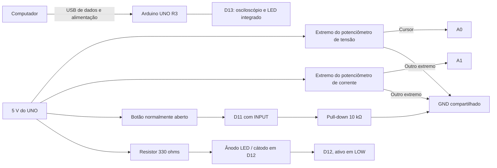

# Bancada SmartGrid — entrega A1/5, issue #66

Responsável: Arthur De Marco Faggion. Revisão de software: 19/11/2026.
Firmware: o fornecido pelo professor, versionado sem alterações em `firmware/smartgrid_placa/smartgrid_placa.ino`. O desktop foi adaptado ao protocolo dele (`models/protocolo.py`).
Este documento prepara a montagem e o ensaio. **Nenhum teste com Arduino real foi executado nesta entrega de software.**

## Materiais

| Quantidade | Material | Observação |
|---|---|---|
| 1 | Arduino UNO R3 / compatível com ATmega328P, 5 V | Alvo de compilação `arduino:avr:uno`; conferir a placa disponível |
| 1 | Cabo USB de dados compatível com a placa | Separar um cabo reserva; cabo somente de carga não serve |
| 2 | Potenciômetros lineares de 10 kΩ | Simulam tensão e corrente, sem sensores ligados a uma instalação |
| 1 | LED e resistor de 330 Ω | Opção mais simples para representar a carga em D12 |
| opcional | Módulo de relé com entrada compatível com lógica de 5 V | Substitui o LED; identificar polaridade de acionamento e consumo |
| 1 | Botão momentâneo normalmente aberto | Entre 5 V e D11 |
| 1 | Resistor de 10 kΩ | Pull-down do botão, de D11 ao GND |
| 1 | Protoboard e conjunto de jumpers | Conferir continuidade das barras de alimentação |
| 1 | Computador com Arduino IDE e ambiente Python do projeto | Deixar dependências instaladas antes da apresentação |
| opcional | Multímetro | Conferência dos 0–5 V dos potenciômetros; não mede os valores simulados de 250 V/20 A |

O alvo é o UNO R3 clássico descrito na [documentação da placa](https://docs.arduino.cc/hardware/uno-rev3), não o UNO R4 ou o UNO Q.

## Montagem em baixa tensão

Monte com o USB desconectado. Use exclusivamente os 5 V do USB para a versão com LED e potenciômetros. **Não conectar a bancada à rede elétrica.** Os valores em volts e amperes exibidos pelo SmartGrid representam a simulação dos potenciômetros.

| Componente | Pino Arduino | Ligação |
|---|---|---|
| Potenciômetro de tensão | A0 | Cursor no A0; extremos em 5 V e GND |
| Potenciômetro de corrente | A1 | Cursor no A1; extremos em 5 V e GND |
| Botão de proteção | D11 | Um contato em 5 V e o outro no D11; resistor de 10 kΩ do D11 ao GND (`INPUT`, pressionado = `HIGH`) |
| LED ou entrada do módulo de relé | D12 | Ativo em LOW (`RELE_ACTIVE_LOW = true`). LED: 5 V → resistor 330 Ω → ânodo; cátodo no D12 |
| Saída para o osciloscópio | D13 | Alterna a cada amostra (onda quadrada de 100 Hz) enquanto a conversão está ligada; o LED integrado acompanha |
| Referência comum | GND | Mesma barra de GND para UNO, potenciômetros, botão e circuito de indicação |



- As entradas A0/A1 devem permanecer entre GND e 5 V. Não deixar o cursor flutuando. Girar os potenciômetros altera o ADC, não aplica tensão de rede ao UNO.
- O D11 usa `INPUT` sem pull-up interno: **o pull-down de 10 kΩ é obrigatório**. Sem ele a entrada flutua e o desktop pode receber acionamentos falsos do botão.
- No botão de quatro terminais, os dois pinos do mesmo contato já podem estar unidos. Identificar os contatos opostos antes de ligar; pressionar deve unir D11 ao 5 V.
- O relé é ativo em LOW: `LOW` em D12 = relé ligado (carga energizada). Por isso o LED vai do 5 V ao D12 e acende quando o pino vai a `LOW`. Módulos de relé comuns já são ativos em LOW: conectar D12 à entrada `IN`, GND à referência e alimentar o módulo conforme sua especificação. Não ligar uma bobina de relé diretamente ao D12. Manter os contatos de potência sem carga ou com carga de baixa tensão isolada.

## O que o firmware faz

| Item | Comportamento |
|---|---|
| Inicialização | Serial a **9600 bps**, relé **desligado**, conversão parada; imprime um banner de texto |
| Velocidades | Exatamente **9600, 19200, 38400 e 115200 bps** |
| Início | `!S<baud>`: responde `>>> ACK: INICIANDO EM <baud> BPS <<<` na velocidade antiga, troca e liga a conversão; baud fora da lista → `>>> ERR: BAUD INVALIDO... <<<` |
| Amostragem | Timer1 a **200 Hz** (`OCR1A = 1249`, prescaler 64): lê A0, A1, relé e botão e envia `$DAT,<A0>,<A1>,<rele>,<botao>*CS` |
| Comandos do relé | `!1`/`!L` liga, `!0`/`!D` desliga, `!T` alterna; resposta `>>> ACK: RELE ... <<<` |
| Pausa | `!P`/`!STOP`: para a conversão e volta a 9600 bps |
| Botão | Só é reportado no campo `botao`; **não atua no relé** |
| Diagnóstico | D13 alterna a cada amostra (100 Hz) durante a conversão; nível baixo em espera |
| Watchdog | Não existe: sem `!P`, a placa continua transmitindo até ser reiniciada |

O que fica no desktop (`SerialWorker`):

- repete `!S<baud>` a 9600 até o ACK (até 6 s, cobrindo o boot do UNO após o DTR) e confirma a velocidade pela primeira amostra válida em até 1 s. Se não chegar nada, envia `!P` e tenta a velocidade menor: 115200 → 38400 → 19200 → 9600;
- converte as contagens em V e A e publica **uma leitura por intervalo** (`taxa_amostragem_ms`), com a média das amostras da janela. Com o relé desligado, a corrente publicada é zero;
- transforma a borda de subida do botão (debounce de 50 ms) em corte: grava a intenção, envia `!0` e só confirma pela telemetria;
- declara **Link perdido** após `3 × intervalo + timeout` sem amostras (4 s com os padrões) e envia `!P` ao desconectar.

**Taxa de transmissão:** cada linha `DAT` tem até ~24 bytes. A 9600 bps cabem cerca de 40 linhas por segundo, então a placa perde amostras (o `Serial.print` bloqueia e o Timer1 sobrescreve as leituras). Funciona, mas 38400 ou 115200 são as velocidades adequadas para os 200 Hz.

**Estado da carga:** `setup()` chama `acionarRele(false)` e o UNO reinicia a cada abertura da porta. Ao conectar, o desktop vê a carga **ABERTO**, registra "Placa iniciou com o relé desligado" no Histórico (status, sem aviso de proteção) e **não religa sozinho**; o operador usa **Religar carga** no Dashboard. Se o banco tinha intenção ABERTO, o estado é confirmado direto.

## Calibração e escala

O firmware do professor envia contagens brutas do ADC. A escala fica no desktop, em `models/protocolo.py`; os valores **não são resultados de calibração experimental**:

| Constante | Valor atual | Uso |
|---|---|---|
| `TENSAO_FUNDO_ESCALA` | `250.0` | Escala simulada em V para ADC = 1023 |
| `CORRENTE_FUNDO_ESCALA` | `20.0` | Escala simulada em A para ADC = 1023 |
| `ADC_MAXIMO` | `1023` | Maior contagem do ADC de 10 bits |

Para os potenciômetros, a conversão é `ADC × fundo_de_escala / 1023`. Com aproximadamente 2,5 V no cursor, espera-se aproximadamente 125 V ou 10 A simulados (corrente somente com o relé ligado). A tensão real medida no cursor continua sendo aproximadamente 2,5 V. O firmware não calcula RMS: a leitura de sensores AC (ZMPT101B/ACS712) exigiria tratar as amostras no desktop.

Procedimento pendente de bancada:

1. Registrar placa, alimentação, versão do firmware, instrumento de referência e constantes iniciais.
2. Conferir extremos e ponto central dos dois potenciômetros com multímetro. Registrar tensão do cursor, valor reportado e repetibilidade; verificar que A0/A1 nunca excedem a alimentação.
3. Escolher e documentar a escala didática desejada. Manter 250 V e 20 A se não houver motivo para mudá-la. Ajustar fundo de escala (em `models/protocolo.py`) muda a simulação, não calibra um sensor físico.
4. Com referência não nula e sinal estável, calcular a correção candidata `fundo_novo = fundo_atual × valor_referencia / valor_exibido`. Não aplicar se o ADC saturar, o valor for zero ou o ruído dominar.
5. Reiniciar o app e repetir medições em pelo menos três pontos; registrar erro e dispersão antes/depois. Só então chamar as escalas de calibradas. Não preencher resultados sem medição. O firmware não precisa ser regravado.

| Data / operador | Modo e canal | Referência | Valor antes | Constante antes/depois | Valor depois / erro | Evidência |
|---|---|---|---|---|---|---|
| Pendente | — | — | — | — | — | — |

No modelo resistivo da demonstração, `P = V × I`. A aplicação não mede fase nem fator de potência; não apresentar essa conta como medição exata de potência ativa de cargas reativas.

## Gravação e primeira conexão

1. Instalar a Arduino IDE para o sistema do computador a partir da [página oficial de software](https://www.arduino.cc/en/software). Instalar o pacote **Arduino AVR Boards** pelo gerenciador de placas, se necessário.
2. Conectar o UNO por USB e selecionar **Arduino Uno** no seletor de placa ou em **Tools/Ferramentas → Board/Placa**.
3. Selecionar a porta que aparece ao conectar a placa: por exemplo `COM3` no Windows, `/dev/ttyACM0` no Linux ou `/dev/cu.usbmodem...` no macOS. Confirmar a porta real, sem assumir esses exemplos.
4. Abrir `firmware/smartgrid_placa/smartgrid_placa.ino`. Conferir `RELE_ACTIVE_LOW = true` e a pinagem desta página (A0, A1, D11, D12, D13).
5. Usar **Verify/Verificar** para compilar. Corrigir erros antes de continuar; guardar saída e versão do pacote AVR.
6. Fechar SmartGrid e qualquer monitor serial que ocupe a porta; usar **Upload/Carregar**. O procedimento de placa, porta e upload está no [guia oficial da IDE 2](https://docs.arduino.cc/software/ide-v2/tutorials/getting-started/ide-v2-uploading-a-sketch/).
7. Fechar o monitor serial da IDE. Abrir o SmartGrid na raiz do projeto: Windows, `.\.venv\Scripts\python.exe main.py`; Linux/macOS, `.venv/bin/python main.py`. As dependências estão em `requirements.txt` e `requirements-dev.txt`.
8. Em **Comunicação Serial**, atualizar as portas, selecionar a porta real, escolher uma das quatro velocidades (de preferência 38400 ou 115200) e um timeout válido (padrão 1000 ms). A taxa de amostragem é o intervalo em que o desktop agrega as amostras de 200 Hz (padrão 1000 ms).
9. Clicar **Conectar** e observar as fases: abertura → handshake a 9600 (`!S<baud>`) → negociação (primeira amostra) → telemetria. Escolher 115200 na tela não muda a velocidade inicial do handshake. A carga aparece ABERTO: religar pelo Dashboard.
10. No Dashboard, girar um potenciômetro por vez: tensão, corrente e potência devem variar; o gráfico deve receber pontos. Conferir a onda de 100 Hz no D13 (osciloscópio) e o evento de conexão no Histórico. Pelo monitor serial da IDE, a placa mostra o banner e aceita `!S115200`, `!1`, `!0` e `!P` digitados à mão.

Compilação opcional por CLI, sem upload:

```text
arduino-cli core update-index
arduino-cli core install arduino:avr
arduino-cli compile --fqbn arduino:avr:uno --warnings all firmware/smartgrid_placa
```

A [documentação do processo de build](https://docs.arduino.cc/arduino-cli/sketch-build-process/) diferencia compilar o `.ino` de gravá-lo na placa. A compilação não valida ligação, calibração nem comunicação elétrica.

## Checklist de aceite com Arduino real

**Todos os itens abaixo estão pendentes.** Para mudar o status, preencher data, operador, configuração, resultado e evidência (foto/vídeo, captura e trecho de log). Uma execução virtual não aprova esta tabela.

| ID | Ensaio e ação | Critério observável | Status / evidência |
|---|---|---|---|
| F01 | Conferir montagem desenergizada e depois ligar USB | Sem curto; A0/A1 em 0–5 V; pinos e polaridade corretos | **Pendente** |
| F02 | Verificar e gravar o firmware no UNO | IDE confirma upload; monitor serial a 9600 mostra o banner "PLACA EM ESPERA" | **Pendente** |
| F03 | Conectar escolhendo 9600 bps | Handshake começa em 9600 e termina em telemetria a 9600 | **Pendente** |
| F04 | Desconectar e conectar escolhendo 19200 bps | Handshake começa em 9600; negociação confirma 19200 | **Pendente** |
| F05 | Repetir escolhendo 38400 bps | Handshake começa em 9600; negociação confirma 38400 | **Pendente** |
| F06 | Repetir escolhendo 115200 bps | Handshake começa em 9600; negociação confirma 115200 | **Pendente** |
| F07 | Girar somente o potenciômetro A0 | Indicador de tensão varia conforme a escala; corrente permanece aproximadamente estável | **Pendente** |
| F08 | Girar somente o potenciômetro A1, carga fechada | Corrente e potência variam; tensão permanece aproximadamente estável | **Pendente** |
| F09 | Observar pelo menos 30 s de telemetria | Onda de 100 Hz no D13, indicadores e gráfico atualizando, navegação responde | **Pendente** |
| F10 | Confirmar CORTE DE EMERGÊNCIA | D12/relé desliga, badge ABERTO, corrente zero, evento persistido com dispositivo | **Pendente** |
| F11 | Confirmar RELIGAR CARGA | D12/relé liga, corrente retorna, novo evento persistido | **Pendente** |
| F12 | Com a carga ligada, pressionar e soltar o botão D11 | Evento "Botão de proteção acionado", o app envia `!0`, relé desliga, aviso de proteção; depois religar com confirmação | **Pendente** |
| F13 | Remover USB durante telemetria | App sinaliza Link perdido, indicadores param, comandos indisponíveis e GUI permanece navegável | **Pendente** |
| F14 | Recolocar USB, atualizar portas e reconectar manualmente | Novo handshake a 9600, telemetria retomada, estado alinhado ao banco | **Pendente** |
| F15 | Desconectar pelo app com telemetria ativa | App envia `!P`; a placa para a conversão, D13 fica em nível baixo e o monitor serial a 9600 volta a aceitar comandos | **Pendente** |
| F16 | Filtrar Histórico e reiniciar o app | Eventos confirmados permanecem; filtros tipo/data/dispositivo corretos após integrar #63 | **Pendente** |
| F17 | Fechar o app com telemetria ativa | Workers encerram, porta liberada, sem aviso de QThread destruída em execução | **Pendente** |

Após queda, aguardar a thread serial anterior encerrar, clicar Atualizar portas e Conectar. A aplicação cria outro `SerialWorker`; **não há reconexão automática**. Se a porta mudou, selecionar o nome novo.

Se o upload falhar, conferir placa, cabo de dados, porta e aplicações que a ocupam. O [guia de falhas de upload da Arduino](https://support.arduino.cc/hc/en-us/articles/4403365313810-If-your-sketch-doesn-t-upload) detalha a investigação; não trocar firmware ou fatores de calibração para tentar corrigir uma porta ocupada.

## Plano B — placa virtual

`tools/simulador_placa.py` usa `os.openpty()`, `tty` e descritores POSIX. Funciona em Linux/macOS; **não roda diretamente no Python nativo do Windows**, onde o import de `tty` falha por ausência de `termios`. Essa restrição é compatível com a [disponibilidade Unix de pseudoterminais no Python](https://docs.python.org/3/library/pty.html).

Alternativas para a apresentação:

1. Notebook Linux ou macOS com o app e o simulador na mesma máquina: opção direta.
2. Windows com uma distribuição Linux no **WSL 2 + WSLg**, previamente preparada. Executar tanto o SmartGrid quanto o simulador dentro da mesma distribuição; não colar `/dev/pts/N` no app Windows. O suporte gráfico depende dos requisitos de versão e drivers descritos no [guia oficial do WSLg](https://learn.microsoft.com/en-us/windows/wsl/tutorials/gui-apps).
3. Máquina virtual Linux com ambiente gráfico. App e simulador devem compartilhar o mesmo ambiente e a mesma pty. Não é necessário encaminhar USB para simular.

Preparar um clone Linux separado, por exemplo `~/SmartGrid`; não reutilizar o `.venv` criado pelo Windows. Em uma distribuição Ubuntu já instalada, confirmar Python, `python3-venv` e as bibliotecas de execução do Qt. Dependências de X11/`xcb` variam entre distribuições; consultar os [requisitos oficiais do Qt](https://doc.qt.io/qt-6/linux-requirements.html) em caso de erro de plugin. `QT_QPA_PLATFORM=offscreen` serve aos testes, não à apresentação visual.

No terminal Linux/macOS, a partir da raiz do clone:

```bash
python3 -m venv .venv
.venv/bin/python -m pip install -r requirements-dev.txt
.venv/bin/python tools/simulador_placa.py
```

Manter esse terminal aberto. Em outro terminal, no mesmo clone e ambiente:

```bash
.venv/bin/python main.py
```

Copiar o caminho realmente impresso pelo simulador (`/dev/pts/N` em Linux, normalmente `/dev/ttys...` em macOS) para o campo editável de porta serial; escolher a velocidade e conectar. No terminal do simulador, digitar a letra **e Enter**:

| Entrada | Efeito |
|---|---|
| `b` | Pressiona o botão virtual por 200 ms; o app comanda o corte (`!0`) |
| `x` | Fecha o mestre da pty e termina o simulador; o app deve detectar Link perdido |
| `q` ou Ctrl+C | Encerra o simulador |

Depois de `x`, executar o simulador novamente, copiar a nova porta e reconectar o app manualmente. Não reutilizar um caminho antigo sem conferir.

Para demonstrar fallback, começar uma instância nova:

```bash
.venv/bin/python tools/simulador_placa.py --falhar-em 115200
```

Escolher 115200 no app. O simulador aceita o `!S115200`, mas não envia amostras nessa velocidade; o desktop envia `!P` e a negociação deve concluir em 38400. A pty não impõe baud rate elétrico: isso valida a sequência lógica e os estados, não a qualidade do enlace do UNO a 115200.

Recursos: banner do boot, `!S` nas quatro velocidades lógicas, amostras `DAT` sintéticas a 200 Hz, relé `!1`/`!0`/`!T` com ACK, botão `b`, `!P` e fechamento `x`. Limitações: não lê potenciômetros, não aciona LED/relé, não emula reset por DTR, ruído elétrico, conversor USB ou calibração; os valores são sintéticos e não há comando de console para fixar tensão/corrente. Não declarar os ensaios F01–F17 concluídos a partir do simulador.

Testes automatizados existentes para preparar o Plano B, no Linux/macOS:

```bash
.venv/bin/python -m pytest -q tests/test_protocolo.py tests/test_serial_worker.py tests/test_aplicacao_controller.py
```

Não editar ou suprimir esses testes para simular aprovação no Windows.

| ID | Ensaio virtual/manual | Status / evidência |
|---|---|---|
| V01 | App gráfico + simulador, handshake nas quatro opções e gráfico | **Pendente de execução em Linux/macOS ou WSLg** |
| V02 | Religamento após conectar, corte e comando `b` | **Pendente** |
| V03 | Comando `x`, GUI responsiva e reconexão com nova pty | **Pendente** |
| V04 | `--falhar-em 115200` resulta em 38400 | **Pendente** |
| V05 | Ensaio completo de 18 minutos usando Plano B | **Pendente** |

## Evidências disponíveis nesta revisão

- O firmware anterior do grupo (handshake `HS`/`SYNC`, telemetria `TLM`) foi substituído pelo firmware do professor. A compilação registrada antes se referia ao firmware antigo; a compilação do firmware atual está **pendente**. Não houve upload.
- Revisão do simulador e de seus comandos: realizada sobre a `main` citada. Execução POSIX e apresentação gráfica do Plano B: **pendentes neste ambiente Windows**.
- Upload, medições, calibração, acionamento físico, quatro velocidades elétricas e remoção/reconexão do cabo: **não executados**.
- A issue #66 só satisfaz o aceite físico após preencher os checklists e ensaiar com os quatro integrantes. O histórico final e o diálogo de limites assíncrono exigem integrar as entregas #63 e #62, respectivamente; esta branch de documentação continua independente delas.

## Preparação para transportar

- UNO montado e identificado; dois potenciômetros e botão acessíveis; LED/relé visível; USB principal e reserva.
- Firmware correto já gravado; captura do upload e registros F01–F17 quando executados.
- Versão final integrada do app, dependências, banco demonstrativo e backup de `data/config.json` conforme o [roteiro](roteiro-demonstracao.md).
- Notebook/ambiente do Plano B já ensaiado; terminais separados; carregador; capturas locais e vídeo curto de contingência, identificados como gravação.
- Cronômetro, roteiro e tabela de evidências com data/operador, sem marcar testes pendentes como aprovados.
