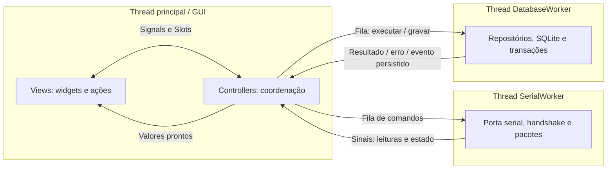

# Seminário SmartGrid — entrega final A1/5

Tempo alvo: **18 minutos**, com até 2 minutos de margem para o boot da placa e transições. Arguição após a exposição. Cada integrante tem **4 min 30 s** de fala/execução.

| Integrante | Responsabilidade na demonstração |
|---|---|
| Samuel De Marco | Objetivo, arquitetura geral, Dashboard, telemetria e comandos de carga |
| Davy Josias Scheuermann | Comunicação serial, protocolo, handshake, estados, falha USB e Plano B |
| Lucas Zamoner Locatelli | Limites, validações, persistência de regras e configurações, resultados de testes |
| Arthur De Marco Faggion | Histórico MVC, filtros e auditoria, bancada, disparo e integridade transacional |

O apresentador indicado opera a tela durante seu bloco; Arthur manipula o circuito quando necessário. Um cronômetro permanece visível para a equipe.

## Condições para o ensaio final

1. Usar uma versão final integrada e identificada por commit. A documentação da #66 parte da `main` em `b01860e`, de 19/11/2026, e sua branch não contém a implementação da #63. A coluna/filtro de dispositivo e o novo histórico dependem da integração da #63. O diálogo MVC com gravação assíncrona e atualização dos limites no JSON depende da #62. Não apresentar funcionalidades pendentes como concluídas; verificar a versão antes do ensaio.
2. Montar e validar a bancada de baixa tensão conforme [bancada.md](bancada.md). Todos os ensaios físicos permanecem pendentes até haver registro de execução com Arduino real.
3. Gravar o firmware, conferir os quatro baud rates e deixar o cabo USB acessível. Nunca conectar a montagem à rede elétrica. Identificar A0, A1, D11 (botão com pull-down), D12 (relé, ativo em LOW) e D13 (osciloscópio) para explicar sem desmontar.
4. Preparar um banco demonstrativo com eventos de dias/tipos/dispositivos diferentes e pelo menos um evento sem vínculo. Usar dados identificados como preparação de ensaio; não atribuir telemetria sintética a medições reais. Não apagar o banco durante o seminário.
5. Instalar dependências, ensaiar inicialização e encerramento, verificar porta e log. Manter Arduino Serial Monitor fechado. Deixar o modo de falha simulada **desligado** no início (`Ctrl+Shift+F` alterna o selo).
6. Fazer backup de `data/config.json` com o aplicativo fechado e guardar capturas do estado inicial. Preparar os comandos da seção de JSON em um terminal; testar e restaurar no ensaio.
7. Preparar previamente o Plano B em Linux/macOS ou WSL 2 com WSLg. App e simulador rodam no mesmo ambiente. Ter uma gravação local identificada como contingência caso também falhe o ambiente virtual.
8. Registrar data, versão, operadores e resultados nos checklists. Upload, calibração, comportamento físico e ensaio presencial **não foram executados por esta entrega de software**.

## Ordem e divisão do tempo

| Tempo | Duração | Quem | Bloco |
|---|---|---|---|
| 00:00–01:00 | 1:00 | Samuel | Problema e objetivo |
| 01:00–02:30 | 1:30 | Samuel | MVC e três threads |
| 02:30–04:30 | 2:00 | Davy | Protocolo e handshake ao vivo |
| 04:30–05:30 | 1:00 | Samuel | Telemetria e indicadores |
| 05:30–07:30 | 2:00 | Arthur | Histórico, filtros e auditoria |
| 07:30–10:00 | 2:30 | Lucas | Limites, validações e persistência |
| 10:00–11:00 | 1:00 | Samuel | Corte e religamento |
| 11:00–12:00 | 1:00 | Arthur | Bancada e disparo espontâneo |
| 12:00–13:30 | 1:30 | Davy | Falha USB e reconexão |
| 13:30–15:00 | 1:30 | Lucas | Ausência do JSON e recriação dos padrões |
| 15:00–16:00 | 1:00 | Arthur | Falha transacional induzida e auditoria |
| 16:00–17:00 | 1:00 | Davy | Plano B e suas limitações |
| 17:00–17:30 | 0:30 | Lucas | Evidências e testes pendentes |
| 17:30–18:00 | 0:30 | Arthur | Encerramento e conclusões |
| **Total** | **18:00** | **4:30 por pessoa** | **Até 20:00 com margem** |

Se o handshake ou a recuperação consumir a margem, mostrar a evidência já capturada e continuar. Não repetir indefinidamente uma operação diante da banca. O ensaio normal deve caber em 18 minutos; testar as quatro velocidades na preparação e mostrar uma ao vivo, exibindo os registros das outras três.

## Falas, ações e critérios observáveis

### 00:00–01:00 — Samuel: problema e objetivo

Fala sugerida: “O SmartGrid é um supervisório didático de uma carga elétrica. Recebemos tensão, corrente e estado do disjuntor da placa, mostramos a telemetria, aplicamos limites de alerta e registramos as operações para consulta posterior. Nesta bancada, os potenciômetros simulam as grandezas em baixa tensão.”

Mostrar o circuito e a janela inicial. Identificar brevemente o trabalho de cada integrante. Diferenciar supervisão, sinalização de alerta e comando de corte: não prometer corte automático por limite se essa função não existe.

Transição: “Samuel mostra como o software separa essas responsabilidades; depois Davy estabelece o link com a placa.”

### 01:00–02:30 — Samuel: arquitetura MVC e concorrência

Mostrar este diagrama ou os diretórios do projeto:



Fala: “A View desenha e emite ações. O Controller decide qual operação pedir. O Model contém protocolo, regras e repositórios. Os arquivos `_ui.py` são gerados pelo Qt Designer e pelo `pyuic6`, sem lógica de negócio. `AplicacaoController` cria um `DatabaseWorker` compartilhado e um novo `SerialWorker` a cada conexão. A serial e o SQLite trabalham nas suas threads; a GUI recebe sinais e callbacks.”

Destacar o histórico como exemplo: filtro → pedido ao worker → retorno → preenchimento em lotes. Não afirmar que qualquer método de uma subclasse de `QThread` roda automaticamente no segundo plano; a fila é consumida dentro de `run()`. A inicialização de config/esquema é anterior à operação normal; a auditoria das demais telas depende da integração das respectivas entregas.

### 02:30–04:30 — Davy: protocolo, velocidades e handshake

1. Abrir **Comunicação Serial**, atualizar portas e escolher a porta efetiva da bancada. Mostrar timeout válido e a velocidade alvo, por exemplo 38400.
2. Explicar `$CORPO*CS` seguido de quebra de linha. O corpo é ASCII, separado por vírgulas; `CS` é XOR dos bytes do corpo em dois dígitos hexadecimais. O checksum detecta erros de transmissão; não é criptografia.
3. Clicar **Conectar**, acompanhando abertura, handshake, negociação e telemetria. Mostrar o log se as fases passarem rápido demais na tela.
4. Narrar a sequência: “A conexão sempre começa a 9600. Enviamos `!S38400`; a placa responde `ACK: INICIANDO EM 38400 BPS` ainda a 9600 e troca. A velocidade só é confirmada quando chega a primeira amostra `$DAT,...*CS` válida. A placa amostra a 200 Hz e o desktop publica a média de cada intervalo configurado.”
5. Exibir o checklist do ensaio nas quatro opções: 9600, 19200, 38400 e 115200. Se ainda não houver execução física, declarar a pendência. Explicar o fallback: sem amostras na velocidade nova, o desktop envia `!P` (a placa volta a 9600) e tenta a velocidade menor.

Resultado esperado: telemetria ativa, onda de 100 Hz no D13, carga ABERTO (o firmware liga com o relé desligado) e evento de conexão persistido. Religar a carga pelo Dashboard antes de passar a palavra. Deixar a placa conectada para Samuel.

### 04:30–05:30 — Samuel: telemetria e indicadores

Girar A0 e A1 separadamente, devagar. Mostrar tensão, corrente, potência e novos pontos no gráfico em **Tempo real**. Explicar `P = V × I`: representa o modelo resistivo da bancada; não mede fator de potência ou potência ativa exata em uma carga reativa.

Abrir o modo **Histórico** do gráfico e consultar as últimas N leituras ou um intervalo válido. Mostrar que o gráfico usa leituras persistidas e que a consulta é assíncrona. Voltar a Tempo real; a recepção continuou durante a consulta. Evitar confundir histórico de medições com histórico de eventos.

### 05:30–07:30 — Arthur: histórico de eventos

1. Abrir **Histórico** e indicar Data/Hora, Tipo, Descrição, Valor Medido e Dispositivo, após integrar #63.
2. Aplicar tipo **Comando**, uma data inicial já preparada e o dispositivo **DISJ-01**. Explicar que os filtros se combinam e que **Todos os dispositivos** também inclui eventos sem vínculo, apresentados como **Sem dispositivo**.
3. Alternar filtros e retornar ao estado geral. Mostrar a indicação de carregamento e a navegação responsiva com o conjunto preparado de milhares de registros.
4. Fala: “O sinal `evento_registrado` pede gravação. Só `evento_persistido`, após o commit, permite atualizar o histórico. Agrupamos notificações e consultamos apenas IDs novos com o dispositivo real por LEFT JOIN. O ID evita duplicatas sem eliminar eventos distintos com texto e horário iguais.”
5. Explicar proteção contra respostas antigas de filtros. Abrir a confirmação de **Limpar histórico** e escolher **Não** para preservar as evidências da apresentação. A limpeza efetiva é ensaiada em banco descartável e tem retorno assíncrono de sucesso ou erro.

Resultado esperado: dados coerentes com o filtro, nenhum evento inventado antes da persistência e consulta sem travar a janela.

### 07:30–10:00 — Lucas: limites e validações

Pré-condição: integração da #62 para demonstrar MVC, gravação assíncrona e atualização de `limites_iniciais` no JSON. Na `main` de referência, essas mudanças ainda eram uma dependência; não afirmar que já estavam presentes.

1. Abrir **Configurar Limites** pelo Dashboard. Explicar nome, grandeza, limite máximo e estado ativo.
2. Mostrar uma tentativa inválida preparada no ensaio (campo obrigatório vazio ou valor fora da faixa permitida) e a mensagem correspondente. Não inventar uma entrada que o widget numérico nem permite digitar.
3. Configurar pelo menos duas regras válidas, como tensão e corrente, dentro da escala simulada e próximas aos valores atuais. Salvar; mostrar o botão indisponível enquanto a gravação assíncrona está pendente e o retorno ao Dashboard após sucesso.
4. Conferir o resumo das regras, o banco e os limites salvos no JSON conforme a versão integrada. Girar A0/A1 além de um limite, observar o alerta e o evento correspondente; normalizar a leitura.
5. Distinguir alerta de atuação: os limites sinalizam a violação e a auditoria. O corte demonstrado a seguir é uma ação confirmada pelo operador; o botão físico é outro caminho de disparo.

Fala: “Validamos antes de gravar e executamos o I/O de regras no worker. Em falha, avisamos o operador e preservamos a consistência da transação. O JSON guarda configuração; o SQLite guarda as entidades e a auditoria.”

### 10:00–11:00 — Samuel: corte de emergência e religamento

Conferir modo de falha desligado e conexão ativa. Mostrar a carga fechada e clicar **CORTE DE EMERGÊNCIA**; ler e aceitar a confirmação. Arthur indica D12/relé desligado. Conferir badge ABERTO, corrente zero e novo evento no Histórico.

Clicar **RELIGAR CARGA**, confirmar e observar o retorno do indicador físico e da corrente. Fala: “Atualizamos os estados e o evento em uma transação. Só depois do commit o comando de relé é encaminhado à placa. A confirmação serial é acompanhada no log; o banco não torna o hardware parte de uma transação ACID.”

### 11:00–12:00 — Arthur: bancada e disparo espontâneo

Apontar A0/A1, D11 com pull-down, D12 e D13. Explicar que não há conexão de rede e que a escala exibida é simulada. Com carga fechada, pressionar e soltar o botão em D11. O firmware só reporta o botão no campo `botao` da amostra; o desktop detecta a borda, grava a intenção, envia `!0` e, quando a telemetria confirma o relé desligado, mostra o aviso de proteção e persiste os eventos vinculados ao dispositivo.

Mostrar a nova linha de auditoria. Soltar completamente o botão, fechar o aviso e religar mediante confirmação. Se a persistência falhar após um disparo real, a tela deve continuar mostrando ABERTO e avisar sobre o registro: software não pode desfazer uma proteção que já atuou fisicamente.

### 12:00–13:30 — Davy: perda USB e recuperação

Arthur remove o cabo USB durante a telemetria. Davy narra: “O worker detecta erro de I/O ou silêncio; o estado passa para Link perdido. Sem novas amostras os indicadores param e os comandos ficam indisponíveis, mas a GUI continua processando ações.” Navegar pelo Histórico enquanto o link está indisponível e mostrar o evento de perda quando persistido.

Reconectar fisicamente, aguardar a enumeração da porta e o encerramento do worker antigo. Atualizar portas, selecionar o nome correto e clicar **Conectar**. Mostrar um novo handshake a 9600 e a retomada da telemetria. A reconexão atual é **manual**, com novo worker.

Ressalva da demonstração: se o UNO só recebe energia pelo USB, removê-lo também desliga a placa. O firmware do professor não tem watchdog de comunicação: quem detecta a queda é o desktop, pelo silêncio acima de 3 × intervalo + timeout. Ao reconectar, o UNO reinicia pelo DTR e volta com o relé desligado; o app não religa sozinho.

### 13:30–15:00 — Lucas: exclusão controlada e recriação do JSON

Usar o procedimento seguro abaixo, preparado no ensaio. Desconectar e **fechar o aplicativo** antes de copiar ou excluir arquivos. Remover somente `data/config.json`, após verificar o backup. Reiniciar o app; mostrar o arquivo recriado, os padrões e a mensagem de criação no log. Não apagar `smartgrid.db`.

Padrões esperados na versão de referência: `porta_com: COM1`, `baud_rate: 115200`, `timeout_ms: 1000`, `taxa_amostragem_ms: 1000`, limites iniciais de 15 A, 230 V e 3500 W e `simular_falha_corte: false`. A placa ainda começa o handshake a 9600. O campo de porta padrão pode não corresponder à bancada; restaurar a configuração e selecionar a porta real antes de reconectar.

Fechar novamente, guardar opcionalmente o JSON recriado como evidência e restaurar o backup. Conferir seu hash, reiniciar e reconectar. Explicar que, na implementação de referência, os limites iniciais semeiam um banco novo; recriar o JSON não apaga ou redefine as regras já persistidas no SQLite. Conferir eventuais mudanças da #62 na versão integrada.

### 15:00–16:00 — Arthur: falha transacional induzida

Com carga fechada, anotar estado e último evento. Ativar `Ctrl+Shift+F` e indicar o selo **MODO DE TESTE: falha simulada**. Solicitar o corte e confirmar. Mostrar a mensagem de rollback: os estados no banco e o evento da tentativa não devem ser confirmados, nem deve ser enviado o corte à placa.

Conferir o Histórico e o log (`Rollback executado`). Desativar o modo de teste imediatamente. Repetir o corte com sucesso e, se necessário, religar. Distinguir essa injeção de falha no banco da remoção USB anterior. Não afirmar que rollback desfaz um disparo físico ou que SQLite e relé formam uma única transação distribuída.

### 16:00–17:00 — Davy: Plano B

Apresentar o ambiente alternativo preparado conforme [bancada.md](bancada.md#plano-b--placa-virtual). No terminal do simulador: `b` + Enter pressiona o botão, `x` + Enter fecha a pty e `q` + Enter encerra. Depois de `x`, reiniciar o simulador e usar o caminho novo para reconectar. `--falhar-em 115200` permite exercitar fallback para 38400.

Fala: “A máquina de estados e os pacotes são os mesmos, mas a pty não impõe a velocidade elétrica. Não há potenciômetros, relé físico, ruído ou calibração. No Windows precisamos de Linux/macOS, VM ou WSL 2 com o app também no Linux; o Python Windows não possui `termios`.”

Na apresentação normal, mostrar uma captura do ensaio do Plano B e seus comandos, sem trocar todo o ambiente em um minuto. Se a bancada falhar, acionar o ambiente virtual já aberto e identificar claramente a mudança. O Plano B não aprova os testes de hardware.

### 17:00–17:30 — Lucas: evidências de validação

Mostrar uma tabela curta com data/commit e três grupos: testes automatizados aprovados, testes não executados ou com falhas conhecidas e ensaios físicos. Na revisão desta entrega houve compilação para UNO e testes do histórico; a suíte completa no Windows encontrou módulos dependentes de POSIX e uma falha preexistente do teste de Dashboard. Consultar o relatório da versão integrada antes de informar totais.

Não mostrar uma marca verde para teste pendente, nem chamar compilação de upload. Evidências físicas e o ensaio do Plano B permanecem pendentes até sua execução pela equipe.

### 17:30–18:00 — Arthur: encerramento

Conferir modo de teste desligado, configuração restaurada e carga no estado combinado. Desconectar a serial e fechar o SmartGrid, mostrando a liberação da porta e a parada cooperativa dos workers. Fala: “Entregamos supervisão com separação de responsabilidades, comunicação negociada e auditoria persistente. A evolução exige completar as evidências da bancada e medir as limitações físicas; a simulação facilita repetir cenários, mas não substitui essas medições.” Abrir para perguntas.

## Comandos para o teste de configuração

Executar somente no clone usado na demonstração, a partir da raiz, com o app fechado. Os comandos não foram executados sobre a configuração pessoal nesta entrega.

### PowerShell — backup e exclusão de um único arquivo

```powershell
$configDemo = (Resolve-Path -LiteralPath '.\data\config.json' -ErrorAction Stop).Path
$dataDemo = (Resolve-Path -LiteralPath '.\data' -ErrorAction Stop).Path
if ($configDemo -ne (Join-Path $dataDemo 'config.json')) { throw 'Caminho inesperado' }
$pastaBackupDemo = Join-Path $env:TEMP ('SmartGrid-demo-' + (Get-Date -Format 'yyyyMMdd-HHmmss'))
New-Item -ItemType Directory -Path $pastaBackupDemo -ErrorAction Stop | Out-Null
$backupConfigDemo = Join-Path $pastaBackupDemo 'config-original.json'
Copy-Item -LiteralPath $configDemo -Destination $backupConfigDemo -ErrorAction Stop
$hashConfigDemo = (Get-FileHash -LiteralPath $configDemo -Algorithm SHA256).Hash
if ((Get-FileHash -LiteralPath $backupConfigDemo -Algorithm SHA256).Hash -ne $hashConfigDemo) {
    throw 'Backup não confere; não excluir o original'
}
Remove-Item -LiteralPath $configDemo -ErrorAction Stop
.\.venv\Scripts\python.exe main.py
```

Enquanto o app está aberto, inspecionar o JSON recriado em outra janela do editor/terminal. **Fechar o app** para continuar no mesmo terminal e restaurar:

```powershell
Copy-Item -LiteralPath $configDemo -Destination (Join-Path $pastaBackupDemo 'config-padroes-gerado.json') -ErrorAction Stop
Copy-Item -LiteralPath $backupConfigDemo -Destination $configDemo -Force -ErrorAction Stop
if ((Get-FileHash -LiteralPath $configDemo -Algorithm SHA256).Hash -ne $hashConfigDemo) {
    throw 'Restauração não confere'
}
.\.venv\Scripts\python.exe main.py
```

O backup fica fora do repositório e é preservado. Se a aplicação não recriar o JSON, registrar a falha e restaurar diretamente o backup, sem depender da cópia opcional do arquivo gerado. Se o arquivo original não existir na preparação, inicializar e fechar o app antes de iniciar o procedimento.

### Linux/macOS — no ambiente do Plano B

```bash
test -f data/config.json || exit 1
pasta_backup_demo=$(mktemp -d)
cp data/config.json "$pasta_backup_demo/config-original.json" || exit 1
cmp data/config.json "$pasta_backup_demo/config-original.json" || exit 1
rm data/config.json
.venv/bin/python main.py
```

Depois de mostrar a recriação e **fechar o aplicativo**:

```bash
cp data/config.json "$pasta_backup_demo/config-padroes-gerado.json"
cp "$pasta_backup_demo/config-original.json" data/config.json || exit 1
cmp "$pasta_backup_demo/config-original.json" data/config.json || exit 1
.venv/bin/python main.py
```

Preservar o diretório indicado por `pasta_backup_demo`. Se o primeiro `cp` do bloco de restauração falhar porque não houve recriação, ainda restaurar `config-original.json`. Não remover a pasta `data`, arquivos SQLite ou backups.

## Perguntas prováveis da banca

| Pergunta | Resposta técnica para ensaio |
|---|---|
| Onde está o MVC? | `views/` contém apresentação e sinais; `controllers/` coordena ações; `models/` contém domínio, protocolo, workers e repositórios. `ui/` contém Designer e código gerado. Mostrar o histórico e o Dashboard como exemplos da versão final integrada. |
| Por que três threads? | A GUI precisa processar pintura e interação; a serial pode esperar bytes; o SQLite pode esperar disco/locks. As filas transferem pedidos e os sinais devolvem resultados. Não compartilhamos conexões SQLite entre essas threads. |
| Uma subclasse de QThread faz todos os métodos rodarem em segundo plano? | Não. O objeto QThread pertence à thread que o criou. Aqui `run()` consome a fila; `executar()` só enfileira. Os callbacks são despachados por sinais na thread da GUI. |
| Por que Signals e Slots? | Desacoplam emissores e receptores e permitem entrega enfileirada entre threads. Widgets são atualizados somente na GUI. O barramento distribui leituras, estados e eventos confirmados. |
| Como evitam congelamento no histórico? | SQLite e conversão dos registros rodam no DatabaseWorker. A View cria células em lotes de 100 linhas; não recalcula a altura de todas as linhas. Notificações são agrupadas e consultam somente IDs novos, não o histórico inteiro. |
| E se dois filtros responderem fora de ordem? | Cada solicitação pertence a uma revisão. Ao mudar o filtro, invalidamos os callbacks anteriores; resultados antigos não substituem a tabela atual. Ao fechar a tela, descartamos os callbacks e usamos referências fracas. |
| Por que não identificar um evento pelo texto ou pelo horário? | Eventos distintos podem ter os mesmos valores. Usamos o ID persistido como identidade. Como `Evento` não carrega dispositivo, a consulta incremental traz a chave e a tag pelo LEFT JOIN, sem inferência pela descrição. |
| Por que SQLite e LEFT JOIN? | SQLite é local e transacional, adequado ao protótipo. A chave estrangeira relaciona evento e dispositivo. LEFT JOIN preserva registros sem vínculo, inclusive quando a FK é colocada em NULL após remoção de dispositivo. SQL usa parâmetros. |
| O que uma transação protege? | Na operação de corte, alterações de dispositivos e inserção do evento são confirmadas juntas. Em exceção antes do commit, rollback restaura o banco. A emissão de confirmação e o comando serial ocorrem após o commit; o efeito físico não é revertido pelo SQLite. |
| WAL resolve qualquer concorrência? | Não. WAL favorece leitores enquanto há escrita, mas SQLite continua com restrições de escrita e pode falhar por lock/disco. Usamos timeout, transações e tratamento de erro; I/O demorado fica fora da GUI durante a operação das telas refatoradas. |
| O que acontece quando uma proteção física atua e o banco falha? | O disjuntor já abriu. O app mostra ABERTO e informa falha de registro; não tenta fechar a carga para simular rollback. É um caso diferente de um comando ainda não enviado. |
| Por que o handshake começa em 9600? | É a velocidade da placa após boot/reset e após `!P`. O alvo é pedido com `!S<baud>` e aceito com `ACK: INICIANDO`; a primeira amostra `DAT` válida confirma a nova velocidade. As opções são 9600, 19200, 38400 e 115200. |
| O checksum garante segurança? | O XOR identifica parte dos erros acidentais e delimita pacotes inválidos; não autentica o host nem protege contra adulteração. Não há criptografia ou garantia de detectar todos os padrões de erro. |
| Qual watchdog foi implementado? | O firmware do professor não tem watchdog. A detecção de queda é do desktop: sem amostras por 3 × intervalo + timeout, o `SerialWorker` declara Link perdido. Ao desconectar, o desktop envia `!P` para a placa parar e voltar a 9600. |
| A reconexão é automática? | Não. O worker da conexão perdida termina. O operador reconecta/atualiza a porta e solicita outra conexão; nasce um novo worker que repete o handshake e alinha o relé ao estado persistido. |
| Como encerram sem destruir QThread ativa? | Pedimos parada cooperativa; o banco drena pedidos anteriores à sentinela, e a serial percebe a interrupção no laço. `finished` liga a `deleteLater`; no encerramento o controller aguarda os workers com prazo e registra falhas. |
| Por que recriar JSON não zera as regras? | Na base de referência, `limites_iniciais` semeia um banco novo; regras existentes estão no SQLite. A entrega #62 sincroniza os limites salvos com o JSON. Backup/restauração não deve apagar o banco. Conferir a versão integrada. |
| O simulador comprova as quatro velocidades físicas? | Não. A pty valida protocolo e lógica de negociação, mas não a UART/USB real. Hardware exige upload, medidas, relé, botão, estabilidade e ensaios nas quatro velocidades no UNO. |
| Quais são os limites da medição? | A montagem usa potenciômetros 0–5 V e escalas didáticas. O modo RMS tem constantes iniciais não calibradas. `V × I` não mede potência ativa exata com defasagem. Precisão e calibração exigem instrumento e ensaio físico. |
| Como sabem quais testes foram feitos? | Cada evidência informa ambiente, commit, comando, resultado e operador. Compilação, teste automatizado, simulação e ensaio físico têm registros separados. Item pendente continua pendente até a execução. |

## Ficha de ensaio da equipe

| Ensaio | Ambiente / commit | Samuel | Davy | Lucas | Arthur | Total / ajustes | Evidência |
|---|---|---|---|---|---|---|---|
| Arduino real | Pendente | — | — | — | — | Meta 18:00; máximo 20:00 | Pendente |
| Plano B | Pendente | — | — | — | — | Repetir os mesmos blocos e identificar simulação | Pendente |

Antes de encerrar o ensaio: configuração restaurada, backup preservado, modo de falha desligado, porta liberada e checklists atualizados somente com evidências reais.
